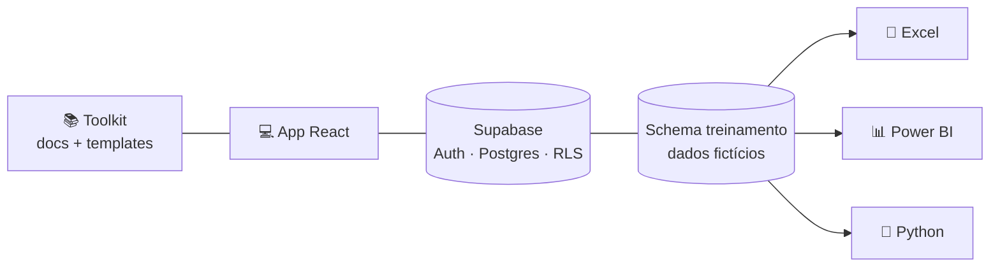

# 📊 DAFA — Toolkit e plataforma de treinamento em Análise de Dados

Programa de **30 dias úteis** (09/11 → 18/12/2026) para profissionais administrativos, em **3 níveis** (Iniciante, Intermediário, Avançado), com app e-learning em **React + Supabase**, login **Google**, perfis **aluno** e **tutor**, entregas avaliadas por tutor e refação ilimitada.



| Quero… | Vá para |
|---|---|
| Entender o programa | [docs/00-visao-geral.md](docs/00-visao-geral.md) |
| Ver o plano dia a dia com datas, dependências e entregáveis | [docs/02-plano-30-dias.md](docs/02-plano-30-dias.md) |
| Conteúdo das sessões | [🌱 Iniciante](docs/toolkit-iniciante.md) · [🚀 Intermediário](docs/toolkit-intermediario.md) · [🏆 Avançado](docs/toolkit-avancado.md) |
| Pesquisa e melhorias | [docs/03-pesquisa-e-melhorias.md](docs/03-pesquisa-e-melhorias.md) |
| Configurar Supabase, Google, Power BI, Python | [docs/04-setup-e-recursos.md](docs/04-setup-e-recursos.md) |
| Arquitetura e telas do app | [docs/05-app.md](docs/05-app.md) |

## Estrutura

```
content/      currículo, templates e recursos (fonte única, editável)
scripts/      gerador de conteúdo, validação SQL, testes de RLS e E2E, geração dos .xlsx
supabase/     migrations: schema do app · dataset de treinamento · seed do currículo
toolkit/      templates prontos (SQL, prompts de IA, diagramas, checklists)
web/          app React (Vite + TypeScript)
docs/         documentação com diagramas Mermaid
```

## Início rápido

```bash
# 1) Banco: aplique as 3 migrations em supabase/migrations (ver docs/04)
# 2) App
cd web && cp .env.example .env.local   # preencha URL e chave do Supabase
npm install && npm run dev
```

## Limitações conhecidas
- Nenhum projeto Supabase foi criado/alterado: as migrations estão prontas para você aplicar (os projetos existentes na conta não foram tocados).
- Login Google e conexão real ao Supabase exigem suas credenciais (guia em docs/04); a UI foi testada com API simulada e o SQL/RLS num Postgres embutido.
- Arquivos `.pbix` não são gerados aqui (binários do Power BI Desktop); há roteiro de construção, medidas DAX e links para os exemplos oficiais.
- 20/11 (Consciência Negra) é considerado dia útil; ajuste `START_DATE` em `content/curriculum.mjs` se sua empresa folgar.
