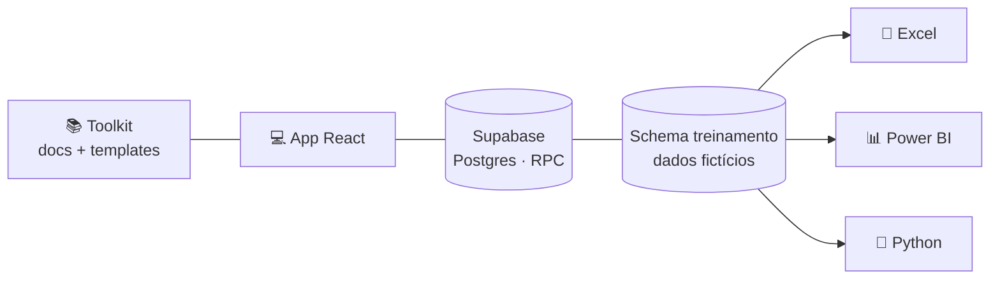
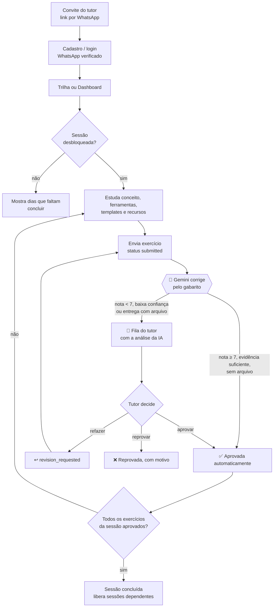

# 📊 DAFA — Toolkit e plataforma de treinamento em Análise de Dados

## Objetivo

Capacitar profissionais administrativos em análise de dados por meio de um programa de **30 dias úteis** (09/11 → 18/12/2026), organizado em **3 níveis** (Iniciante, Intermediário, Avançado). O aluno estuda cada sessão, resolve exercícios práticos sobre um dataset fictício e envia as entregas. Uma **IA (Gemini)** corrige com base em um gabarito por exercício e aprova sozinha quando a nota é ≥ 7; o restante vai para a fila do **tutor**. Quem recebe pedido de ajustes pode refazer quantas vezes precisar, e atrasos nas entregas semanais geram lembretes por WhatsApp.

O projeto reúne duas partes:

- **Toolkit**: currículo, templates e documentação (SQL, prompts de IA, diagramas, checklists).
- **App e-learning**: aplicação web com cadastro por convite, login próprio, trilha de sessões, envio de exercícios, correção por IA, revisão do tutor e alertas de atraso.



## Programas e tecnologias

| Componente | Tecnologia | Para quê |
|---|---|---|
| App web (`web/`) | React 18, TypeScript, Vite, React Router, Recharts, Mermaid | Interface do aluno e do tutor |
| Banco e API | Supabase (Postgres) acessado apenas via RPCs `security definer` | Currículo, usuários, entregas e avaliações |
| Autenticação | Própria do app (e-mail e senha, tabela `app_users`, sessões com token), cadastro por convite e WhatsApp verificado | Perfis **aluno** e **tutor** |
| Correção por IA | Gemini, via Edge Functions do Supabase (`supabase/functions/`) e agendamento `pg_cron` | Nota por gabarito e aprovação automática |
| WhatsApp | Evolution API, chamada pelo servidor (`web/api/`, Vercel) | Convites, verificação do número, recuperação de senha e alertas de atraso |
| Hospedagem do app | Vercel (`web/vercel.json`) | Publicação |
| Ferramentas ensinadas | Excel, Power BI, Python, SQL | Conteúdo das sessões |
| Scripts (`scripts/`) | Node.js (`.mjs`), Python, PGlite | Geração de conteúdo, validação SQL, testes e geração dos `.xlsx` |

### Scripts

| Comando (na raiz) | Função |
|---|---|
| `npm run build:content` | Gera o conteúdo a partir de `content/` |
| `npm run validate:sql` | Valida as migrations SQL |
| `npm run export:dataset` | Exporta o dataset de treinamento |
| `node scripts/test-auth.mjs` / `test-rls.mjs` | Testes de autenticação e regras de acesso (Postgres embutido) |
| `node scripts/e2e-mock.mjs` | Teste da interface com API simulada |

## Fluxo do treinamento

Não há botão "Iniciar": a trilha é fixa, com 30 sessões (dias). O aluno começa ao abrir uma sessão desbloqueada e enviar o primeiro exercício.



1. **Convite e acesso**: o tutor convida o aluno (nome, e-mail e WhatsApp) e o aluno recebe um link por WhatsApp. O cadastro também aceita código de convite, conforme o modo configurado (`open`, `invite` ou `closed`). O número de WhatsApp é verificado por código, e a senha pode ser recuperada por WhatsApp.
2. **Escolha da sessão**: pelo Dashboard ("Continuar: Dia N") ou pela Trilha. Sessões só abrem quando suas dependências estão concluídas. O bloqueio vale na interface e no banco.
3. **Estudo**: a sessão traz abas de conceito, ferramentas, exercícios, templates e recursos.
4. **Envio**: cada exercício gera uma tentativa (`attempt`) com status `submitted`, com texto, link ou arquivo. Enquanto a última tentativa aguarda avaliação, um novo envio é bloqueado.
5. **Correção pela IA**: cada exercício tem de 3 a 5 verificações com peso, e a nota final é a média ponderada calculada no código. A aprovação automática exige nota ≥ 7, evidência textual suficiente, confiança média ou alta, nenhum sinal de manipulação e que a análise não dependa de arquivo ou link lido. Exercícios `text` e `sql` podem ser aprovados sozinhos. Os de tipo `file` recebem só pré-análise, e a decisão é sempre do tutor.
6. **Revisão do tutor**: o que a IA não aprova cai na fila, com a nota e a análise da IA como apoio. O tutor pode aprovar, pedir para refazer (com instruções e exemplo) ou reprovar com motivo. O aluno é notificado em todos os casos.
7. **Refação**: com ajustes solicitados, o aluno envia nova tentativa e o histórico fica preservado. Se o tutor reprovar, o aluno não pode reenviar até o tutor reabrir o exercício.
8. **Conclusão**: a sessão fecha quando todos os seus exercícios têm uma tentativa aprovada.

### Alertas de atraso

As entregas semanais fecham nas sessões dos dias 5, 10, 15, 20, 25 e 30. Se o prazo vence e o aluno não enviou nenhuma tentativa de pelo menos um exercício daquela sessão, ele recebe lembrete por WhatsApp e notificação no app:

- roda em dias úteis, às 09:00 de Brasília;
- no máximo 1 aviso a cada 3 dias e 8 avisos por aluno;
- os tutores recebem um resumo da rodada no app e por WhatsApp;
- o tutor pode pausar e retomar os alertas de cada aluno.

Detalhes e configuração em [docs/07-alertas-de-atraso.md](docs/07-alertas-de-atraso.md).

### Status acompanhados

O status da entrega é gravado no banco (`submissions.status`). Os de exercício e sessão são calculados no cliente (`web/src/lib/progress.ts`).

| Nível | Estados |
|---|---|
| Entrega (banco) | `submitted` → `approved` (IA ou tutor), ou `needs_review` (na fila do tutor) → `approved`, `revision_requested` ou `rejected` |
| Exercício (derivado) | `todo`, `submitted` (inclui `needs_review`), `revision`, `approved`, `rejected` |
| Sessão (derivado) | `locked`, `available`, `in_progress`, `review`, `done` |

O Dashboard mostra o percentual de exercícios aprovados, sessões concluídas, pendências, ajustes, nota média e entregáveis semanais. Os dados são carregados de uma vez (`app_bootstrap`) e só atualizam após enviar, avaliar ou recarregar a página (não há realtime).

## Onde encontrar cada coisa

| Quero… | Vá para |
|---|---|
| Entender o programa | [docs/00-visao-geral.md](docs/00-visao-geral.md) |
| Ver o plano dia a dia com datas, dependências e entregáveis | [docs/02-plano-30-dias.md](docs/02-plano-30-dias.md) |
| Conteúdo das sessões | [🌱 Iniciante](docs/toolkit-iniciante.md) · [🚀 Intermediário](docs/toolkit-intermediario.md) · [🏆 Avançado](docs/toolkit-avancado.md) |
| Pesquisa e melhorias | [docs/03-pesquisa-e-melhorias.md](docs/03-pesquisa-e-melhorias.md) |
| Entender as tabelas e colunas dos exercícios | [docs/dicionario-de-dados.md](docs/dicionario-de-dados.md) |
| Entender as tabelas e colunas dos exercícios | [docs/dicionario-de-dados.md](docs/dicionario-de-dados.md) |
| Configurar Supabase, tutores, Power BI, Python | [docs/04-setup-e-recursos.md](docs/04-setup-e-recursos.md) |
| Arquitetura e telas do app | [docs/05-app.md](docs/05-app.md) |
| Correção automática por IA (Gemini), gabarito dos 67 exercícios e revisão do tutor | [docs/06-correcao-ia.md](docs/06-correcao-ia.md) |
| Alertas de atraso da entrega semanal (WhatsApp + app) e pausa por aluno | [docs/07-alertas-de-atraso.md](docs/07-alertas-de-atraso.md) |
| Correção automática por IA (Gemini), gabarito dos 67 exercícios e revisão do tutor | [docs/06-correcao-ia.md](docs/06-correcao-ia.md) |
| Alertas de atraso da entrega semanal (WhatsApp + app) e pausa por aluno | [docs/07-alertas-de-atraso.md](docs/07-alertas-de-atraso.md) |

## Estrutura

```
content/      currículo, templates e recursos (fonte única, editável)
scripts/      gerador de conteúdo, validação SQL, testes de autenticação/regras e E2E, geração dos .xlsx
supabase/     migrations: schema do app · dataset de treinamento · seed do currículo
toolkit/      templates prontos (SQL, prompts de IA, diagramas, checklists)
web/          app React (Vite + TypeScript)
docs/         documentação com diagramas Mermaid
```

## Início rápido

```bash
# 1) Banco: aplique as migrations de supabase/migrations em ordem, ou cole supabase/apply_all.sql (só em banco novo; ver docs/04)
# 2) App
cd web && cp .env.example .env.local   # preencha URL e chave do Supabase
npm install && npm run dev
```

## Limitações conhecidas
- Nenhum projeto Supabase foi criado/alterado: as migrations estão prontas para você aplicar (os projetos existentes na conta não foram tocados).
- O banco real foi validado por um teste de fumaça direto no Supabase; a interface foi testada com API simulada e as regras de acesso num Postgres embutido (PGlite).
- Arquivos `.pbix` não são gerados aqui (binários do Power BI Desktop); há roteiro de construção, medidas DAX e links para os exemplos oficiais.
- 20/11 (Consciência Negra) é considerado dia útil; ajuste `START_DATE` em `content/curriculum.mjs` se sua empresa folgar.
