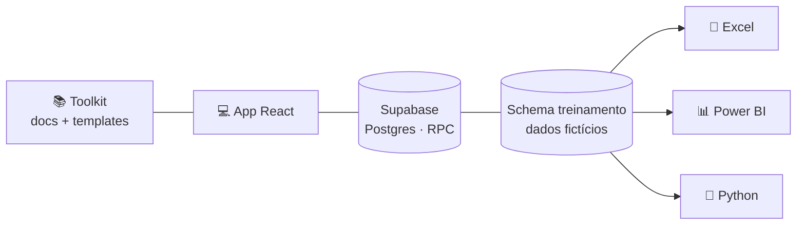
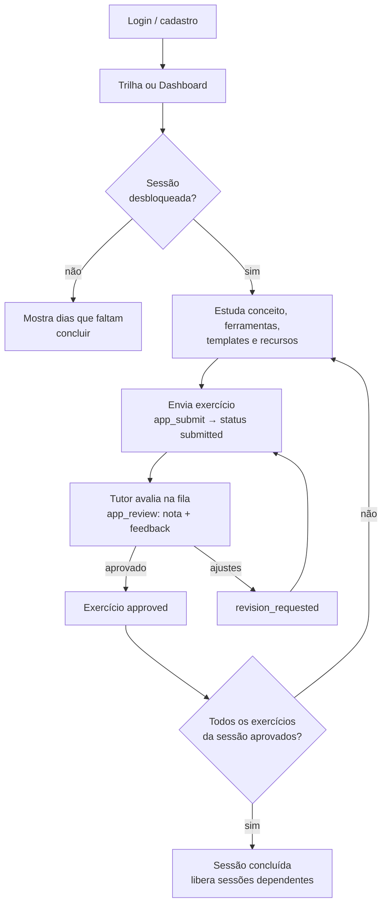

# 📊 DAFA — Toolkit e plataforma de treinamento em Análise de Dados

## Objetivo

Capacitar profissionais administrativos em análise de dados por meio de um programa de **30 dias úteis** (09/11 → 18/12/2026), organizado em **3 níveis** (Iniciante, Intermediário, Avançado). O aluno estuda cada sessão, resolve exercícios práticos sobre um dataset fictício e envia as entregas para um **tutor** avaliar. Quem recebe pedido de ajustes pode refazer quantas vezes precisar.

O projeto reúne duas partes:

- **Toolkit**: currículo, templates e documentação (SQL, prompts de IA, diagramas, checklists).
- **App e-learning**: aplicação web com cadastro/login próprios, trilha de sessões, envio de exercícios e avaliação por tutor.



## Programas e tecnologias

| Componente | Tecnologia | Para quê |
|---|---|---|
| App web (`web/`) | React 18, TypeScript, Vite, React Router, Recharts, Mermaid | Interface do aluno e do tutor |
| Banco e API | Supabase (Postgres) acessado apenas via RPCs `security definer` | Currículo, usuários, entregas e avaliações |
| Autenticação | Própria do app (e-mail e senha, tabela `app_users`, sessões com token) | Perfis **aluno** e **tutor** |
| Hospedagem do app | Vercel (`web/vercel.json`) | Publicação |
| Ferramentas ensinadas | Excel, Power BI, Python, SQL | Conteúdo das sessões |
| Scripts (`scripts/`) | Node.js (`.mjs`), Python, PGlite | Geração de conteúdo, validação SQL, testes e geração dos `.xlsx` |

### Scripts

| Comando (na raiz) | Função |
|---|---|
| `npm run build:content` | Gera o conteúdo a partir de `content/` |
| `npm run validate:sql` | Valida as migrations SQL |
| `npm run export:dataset` | Exporta o dataset de treinamento |
| `node scripts/test-auth.mjs` / `test-rls.mjs` | Testes de autenticação e regras de acesso (Postgres embutido) |
| `node scripts/e2e-mock.mjs` | Teste da interface com API simulada |

## Fluxo do treinamento

Não há botão "Iniciar": a trilha é fixa, com 30 sessões (dias). O aluno começa ao abrir uma sessão desbloqueada e enviar o primeiro exercício.



1. **Acesso**: o aluno se cadastra ou entra (`app_register` / `app_login`).
2. **Escolha da sessão**: pelo Dashboard ("Continuar: Dia N") ou pela Trilha. Sessões só abrem quando suas dependências estão concluídas. O bloqueio vale na interface e no banco.
3. **Estudo**: a sessão traz abas de conceito, ferramentas, exercícios, templates e recursos.
4. **Envio**: cada exercício gera uma tentativa (`attempt`) com status `submitted`. Enquanto a última tentativa aguarda avaliação, um novo envio é bloqueado.
5. **Avaliação**: o tutor vê a fila, dá nota (0–10) e feedback e decide entre aprovar ou pedir ajustes. A nota 7 é só uma referência, o veredito é manual.
6. **Refação**: com ajustes solicitados, o aluno envia nova tentativa. O histórico fica preservado.
7. **Conclusão**: a sessão fecha quando todos os seus exercícios têm uma tentativa aprovada.

### Status acompanhados

O único status gravado no banco é o da entrega (`submissions.status`). Os demais são calculados no cliente (`web/src/lib/progress.ts`).

| Nível | Estados |
|---|---|
| Entrega (banco) | `submitted` → `approved` ou `revision_requested` |
| Exercício (derivado) | `todo`, `submitted`, `revision`, `approved` |
| Sessão (derivado) | `locked`, `available`, `in_progress`, `review`, `done` |

O Dashboard mostra o percentual de exercícios aprovados, sessões concluídas, pendências, ajustes, nota média e entregáveis semanais. Os dados são carregados de uma vez (`app_bootstrap`) e só atualizam após enviar, avaliar ou recarregar a página (não há realtime).

## Onde encontrar cada coisa

| Quero… | Vá para |
|---|---|
| Entender o programa | [docs/00-visao-geral.md](docs/00-visao-geral.md) |
| Ver o plano dia a dia com datas, dependências e entregáveis | [docs/02-plano-30-dias.md](docs/02-plano-30-dias.md) |
| Conteúdo das sessões | [🌱 Iniciante](docs/toolkit-iniciante.md) · [🚀 Intermediário](docs/toolkit-intermediario.md) · [🏆 Avançado](docs/toolkit-avancado.md) |
| Pesquisa e melhorias | [docs/03-pesquisa-e-melhorias.md](docs/03-pesquisa-e-melhorias.md) |
| Configurar Supabase, tutores, Power BI, Python | [docs/04-setup-e-recursos.md](docs/04-setup-e-recursos.md) |
| Arquitetura e telas do app | [docs/05-app.md](docs/05-app.md) |

## Estrutura

```
content/      currículo, templates e recursos (fonte única, editável)
scripts/      gerador de conteúdo, validação SQL, testes de autenticação/regras e E2E, geração dos .xlsx
supabase/     migrations: schema do app · dataset de treinamento · seed do currículo
toolkit/      templates prontos (SQL, prompts de IA, diagramas, checklists)
web/          app React (Vite + TypeScript)
docs/         documentação com diagramas Mermaid
```

## Início rápido

```bash
# 1) Banco: aplique as migrations em supabase/migrations (ver docs/04)
# 2) App
cd web && cp .env.example .env.local   # preencha URL e chave do Supabase
npm install && npm run dev
```

## Limitações conhecidas
- Nenhum projeto Supabase foi criado/alterado: as migrations estão prontas para você aplicar (os projetos existentes na conta não foram tocados).
- O banco real foi validado por um teste de fumaça direto no Supabase; a interface foi testada com API simulada e as regras de acesso num Postgres embutido (PGlite).
- Arquivos `.pbix` não são gerados aqui (binários do Power BI Desktop); há roteiro de construção, medidas DAX e links para os exemplos oficiais.
- 20/11 (Consciência Negra) é considerado dia útil; ajuste `START_DATE` em `content/curriculum.mjs` se sua empresa folgar.
