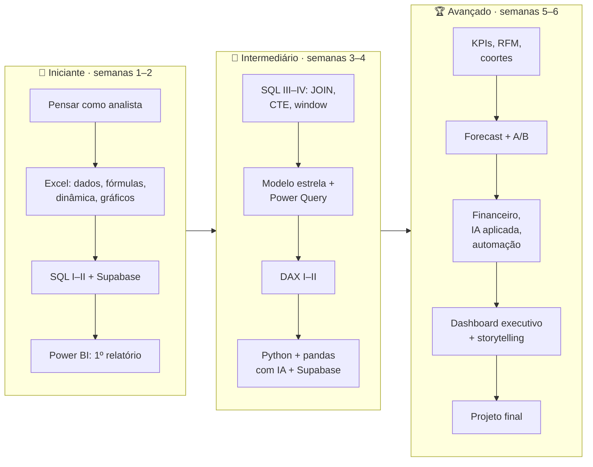
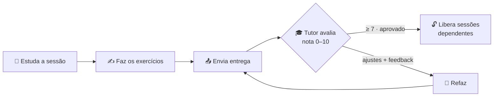

# 🎯 Visão geral do programa DAFA

**Público:** profissionais da área administrativa (comercial, financeiro, logística, e-commerce, esporte e marketing).
**Duração:** 30 dias úteis (09/11/2026 → 18/12/2026), ~2h30 por dia, 3 níveis, 6 entregáveis semanais.
**Ferramentas:** Excel · SQL (Supabase/Postgres) · Power BI Desktop · Python + IA.

## Anatomia de cada sessão (os 5 blocos)

Toda sessão do app segue o mesmo molde, que corresponde às abas **1 a 5**:

| # | Bloco | Responde a… | Onde ver |
|---|---|---|---|
| 1 | **Conceitual** | Por quê? O que aprender? Para quê usar? Cenários por área | aba *Conceito* |
| 2 | **Conexão com ferramentas** | Qual ferramenta resolve e como o conceito se traduz nela | aba *Ferramentas* |
| 3 | **Exercícios** | O que fazer para fixar; entrega e refação | aba *Exercícios* |
| 4 | **Templates** | Planilhas Excel, queries SQL, diagramas, roteiros `.pbix`, prompts de IA para gerar Python | aba *Templates* |
| 5 | **Recursos** | Downloads (Excel, Power BI Desktop, Python), URL do Supabase | aba *Recursos* |

## Ciclo de aprendizagem (mastery learning)

Regras (aplicadas no banco, não só na tela):
- Sessão **concluída** = todos os exercícios com ao menos uma entrega **aprovada**.
- Sessão **liberada** = todas as dependências concluídas (ver mapa em [plano de 30 dias](02-plano-30-dias.md)).
- Enquanto uma entrega aguarda avaliação, não é possível reenviar o mesmo exercício; após "ajustes solicitados", o aluno refaz quantas vezes quiser (tentativas #1, #2, …).

## Documentos

| Documento | Conteúdo |
|---|---|
| [02 · Plano de 30 dias](02-plano-30-dias.md) | Gantt, mapa de dependências, programação diária com datas, entregáveis semanais, critérios |
| Toolkits: [🌱 Iniciante](toolkit-iniciante.md) · [🚀 Intermediário](toolkit-intermediario.md) · [🏆 Avançado](toolkit-avancado.md) | As 30 sessões com os 5 blocos |
| [03 · Pesquisa e melhorias](03-pesquisa-e-melhorias.md) | O que a pesquisa indicou e como entrou no programa |
| [04 · Setup e recursos](04-setup-e-recursos.md) | Supabase, login Google, Power BI, Python, aluno somente-leitura |
| [05 · App de treinamento](05-app.md) | Arquitetura, modelo de dados, segurança, telas |
