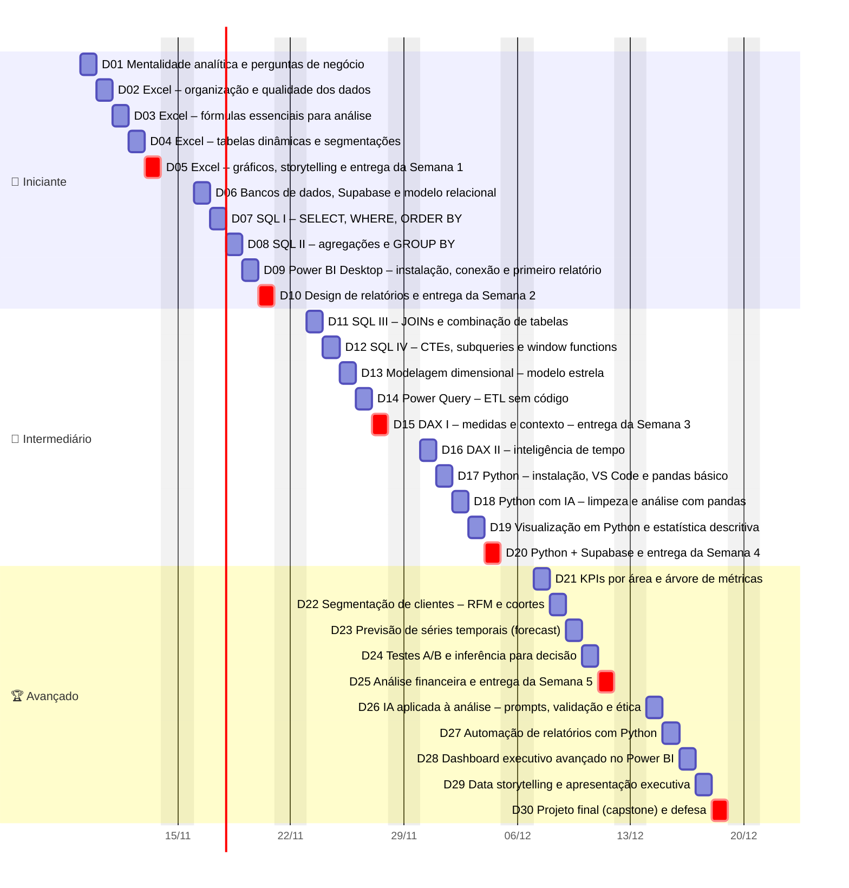
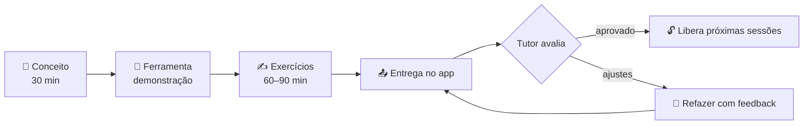
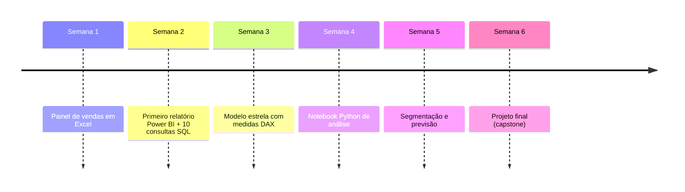

# 📅 Plano de 30 dias úteis

> Início **09/11/2026** (seg) · Fim **18/12/2026** (sex) · sem sábados e domingos · ~2h30/dia.
> Feriado nacional em **20/11 (Consciência Negra)**: o calendário abaixo o considera dia útil. Se sua empresa folgar, desloque o programa em 1 dia (ajuste `START_DATE` em `content/curriculum.mjs` e rode `npm run build:content`).

## Visão geral (Gantt)

## Trilha e dependências

Setas = "precisa estar **aprovado** pelo tutor antes". O app bloqueia sessões cujas dependências não estão concluídas.

```mermaid
flowchart LR
  subgraph iniciante["🌱 Iniciante"]
    D1["D1 · Mentalidade analítica e perguntas de n"]
    D2["D2 · Excel: organização e qualidade dos dad"]
    D3["D3 · Excel: fórmulas essenciais para anális"]
    D4["D4 · Excel: tabelas dinâmicas e segmentaçõe"]
    D5["D5 · Excel: gráficos, storytelling e entreg"]:::entrega
    D6["D6 · Bancos de dados, Supabase e modelo rel"]
    D7["D7 · SQL I: SELECT, WHERE, ORDER BY"]
    D8["D8 · SQL II: agregações e GROUP BY"]
    D9["D9 · Power BI Desktop: instalação, conexão "]
    D10["D10 · Design de relatórios e entrega da Sema"]:::entrega
  end
  subgraph intermediario["🚀 Intermediário"]
    D11["D11 · SQL III: JOINs e combinação de tabelas"]
    D12["D12 · SQL IV: CTEs, subqueries e window func"]
    D13["D13 · Modelagem dimensional: modelo estrela"]
    D14["D14 · Power Query: ETL sem código"]
    D15["D15 · DAX I: medidas e contexto – entrega da"]:::entrega
    D16["D16 · DAX II: inteligência de tempo"]
    D17["D17 · Python: instalação, VS Code e pandas b"]
    D18["D18 · Python com IA: limpeza e análise com p"]
    D19["D19 · Visualização em Python e estatística d"]
    D20["D20 · Python + Supabase e entrega da Semana "]:::entrega
  end
  subgraph avancado["🏆 Avançado"]
    D21["D21 · KPIs por área e árvore de métricas"]
    D22["D22 · Segmentação de clientes: RFM e coortes"]
    D23["D23 · Previsão de séries temporais (forecast"]
    D24["D24 · Testes A/B e inferência para decisão"]
    D25["D25 · Análise financeira e entrega da Semana"]:::entrega
    D26["D26 · IA aplicada à análise: prompts, valida"]
    D27["D27 · Automação de relatórios com Python"]
    D28["D28 · Dashboard executivo avançado no Power "]
    D29["D29 · Data storytelling e apresentação execu"]
    D30["D30 · Projeto final (capstone) e defesa"]:::entrega
  end
  D1 --> D2
  D2 --> D3
  D3 --> D4
  D4 --> D5
  D1 --> D6
  D6 --> D7
  D7 --> D8
  D5 --> D9
  D8 --> D9
  D9 --> D10
  D8 --> D11
  D11 --> D12
  D10 --> D13
  D11 --> D13
  D13 --> D14
  D14 --> D15
  D15 --> D16
  D10 --> D17
  D17 --> D18
  D18 --> D19
  D12 --> D20
  D19 --> D20
  D16 --> D21
  D20 --> D21
  D21 --> D22
  D19 --> D23
  D21 --> D23
  D23 --> D24
  D16 --> D25
  D22 --> D25
  D20 --> D26
  D26 --> D27
  D16 --> D28
  D25 --> D28
  D28 --> D29
  D24 --> D30
  D27 --> D30
  D29 --> D30
  classDef entrega fill:#fde68a,stroke:#d97706,color:#000;
```

## Ciclo de cada dia

## Programação diária

### 🌱 Semana 1 · Iniciante (09/11 – 13/11)

| Dia | Data | Sessão | Objetivo do dia (por quê) | Depende de |
|---|---|---|---|---|
| 1 | seg 09/11 | **Mentalidade analítica e perguntas de negócio** | Análise sem pergunta vira relatório que ninguém usa. | — |
| 2 | ter 10/11 | **Excel: organização e qualidade dos dados** | Cerca de 80% do tempo de uma análise vai para preparar dados. | D1 |
| 3 | qua 11/11 | **Excel: fórmulas essenciais para análise** | Fórmulas permitem responder perguntas de forma repetível e auditável. | D2 |
| 4 | qui 12/11 | **Excel: tabelas dinâmicas e segmentações** | Tabelas dinâmicas são o "GROUP BY visual": respondem em segundos perguntas de resumo e preparam o terreno para entender o modelo de dados do Power BI.. | D3 |
| 5 | sex 13/11 | **Excel: gráficos, storytelling e entrega da Semana 1** 📦 | Um bom gráfico encurta a decisão. | D4 |

> 📦 **Entregável da semana 1:** Painel de vendas em Excel — Planilha com dados limpos, fórmulas, tabela dinâmica e 4 gráficos respondendo a 3 perguntas de negócio, mais o relatório de entrega. _(prazo: sex 13/11)_

### 🌱 Semana 2 · Iniciante (16/11 – 20/11)

| Dia | Data | Sessão | Objetivo do dia (por quê) | Depende de |
|---|---|---|---|---|
| 6 | seg 16/11 | **Bancos de dados, Supabase e modelo relacional** | Dados reais vivem em bancos, não em planilhas soltas. | D1 |
| 7 | ter 17/11 | **SQL I: SELECT, WHERE, ORDER BY** | SQL é a língua franca dos dados. | D6 |
| 8 | qua 18/11 | **SQL II: agregações e GROUP BY** | Decisões raramente usam linhas individuais; usam totais, médias e comparações por grupo. | D7 |
| 9 | qui 19/11 | **Power BI Desktop: instalação, conexão e primeiro relatório** | O Power BI reúne conexão, modelagem e visualização em uma só ferramenta e é o padrão de mercado para dashboards gerenciais interativos.. | D5, D8 |
| 10 | sex 20/11 | **Design de relatórios e entrega da Semana 2** 📦 | Relatório bonito não é enfeite: layout e hierarquia visual guiam a leitura e evitam interpretações erradas.. | D9 |

> 📦 **Entregável da semana 2:** Primeiro relatório Power BI + 10 consultas SQL — Arquivo .pbix de 2 páginas, iniciado no seu Excel e conectado ao Supabase, e um .sql com 10 consultas comentadas. _(prazo: sex 20/11)_

### 🚀 Semana 3 · Intermediário (23/11 – 27/11)

| Dia | Data | Sessão | Objetivo do dia (por quê) | Depende de |
|---|---|---|---|---|
| 11 | seg 23/11 | **SQL III: JOINs e combinação de tabelas** | Quase toda pergunta relevante cruza tabelas (quem comprou o quê, quando, entregue por quem). | D8 |
| 12 | ter 24/11 | **SQL IV: CTEs, subqueries e window functions** | Rankings, acumulados e variações período a período são perguntas diárias de gestão. | D11 |
| 13 | qua 25/11 | **Modelagem dimensional: modelo estrela** | Um bom modelo torna as medidas simples, rápidas e corretas. | D10, D11 |
| 14 | qui 26/11 | **Power Query: ETL sem código** | Transformações feitas no Power Query ficam registradas e se repetem a cada atualização, eliminando a "limpeza manual" mensal.. | D13 |
| 15 | sex 27/11 | **DAX I: medidas e contexto – entrega da Semana 3** 📦 | Medidas DAX calculam números corretos em qualquer filtro. | D14 |

> 📦 **Entregável da semana 3:** Modelo estrela com medidas DAX — Arquivo .pbix com modelo estrela (dim_data, dim_clientes, dim_produtos), Power Query documentado e 8 medidas DAX. _(prazo: sex 27/11)_

### 🚀 Semana 4 · Intermediário (30/11 – 04/12)

| Dia | Data | Sessão | Objetivo do dia (por quê) | Depende de |
|---|---|---|---|---|
| 16 | seg 30/11 | **DAX II: inteligência de tempo** | Gestores comparam sempre com o período anterior. | D15 |
| 17 | ter 01/12 | **Python: instalação, VS Code e pandas básico** | Python automatiza análises repetidas e abre portas para estatística, previsão e IA. | D10 |
| 18 | qua 02/12 | **Python com IA: limpeza e análise com pandas** | Assistentes de IA aceleram a escrita de código, mas só quem sabe especificar e revisar evita erros silenciosos. | D17 |
| 19 | qui 03/12 | **Visualização em Python e estatística descritiva** | Média engana. | D18 |
| 20 | sex 04/12 | **Python + Supabase e entrega da Semana 4** 📦 | Conectar Python direto ao banco elimina exportações manuais e garante que todos analisam a mesma versão dos dados.. | D12, D19 |

> 📦 **Entregável da semana 4:** Notebook Python de análise — Notebook .ipynb (ou .py) que lê o Supabase, limpa, analisa e gera 3 gráficos, com prompts de IA registrados e revisados. _(prazo: sex 04/12)_

### 🏆 Semana 5 · Avançado (07/12 – 11/12)

| Dia | Data | Sessão | Objetivo do dia (por quê) | Depende de |
|---|---|---|---|---|
| 21 | seg 07/12 | **KPIs por área e árvore de métricas** | Métricas soltas confundem; árvores de métricas mostram o que move o resultado e onde agir.. | D16, D20 |
| 22 | ter 08/12 | **Segmentação de clientes: RFM e coortes** | Nem todo cliente vale o mesmo. | D21 |
| 23 | qua 09/12 | **Previsão de séries temporais (forecast)** | Planejar estoque, caixa e metas exige olhar para frente. | D19, D21 |
| 24 | qui 10/12 | **Testes A/B e inferência para decisão** | Testar antes de escalar evita decisões caras baseadas em sorte. | D23 |
| 25 | sex 11/12 | **Análise financeira e entrega da Semana 5** 📦 | Toda análise administrativa termina em impacto financeiro. | D16, D22 |

> 📦 **Entregável da semana 5:** Segmentação e previsão — Relatório com RFM de clientes, previsão de receita de 6 meses e análise financeira (DRE + caixa), com recomendação por área. _(prazo: sex 11/12)_

### 🏆 Semana 6 · Avançado (14/12 – 18/12)

| Dia | Data | Sessão | Objetivo do dia (por quê) | Depende de |
|---|---|---|---|---|
| 26 | seg 14/12 | **IA aplicada à análise: prompts, validação e ética** | A IA multiplica a produtividade, mas também erra com confiança. | D20 |
| 27 | ter 15/12 | **Automação de relatórios com Python** | Se você repete uma análise toda semana, ela deve rodar sozinha: menos esforço, menos erros e mais tempo para interpretar.. | D26 |
| 28 | qua 16/12 | **Dashboard executivo avançado no Power BI** | Executivos têm 2 minutos. | D16, D25 |
| 29 | qui 17/12 | **Data storytelling e apresentação executiva** | Uma análise só gera valor se for compreendida e levar à ação. | D28 |
| 30 | sex 18/12 | **Projeto final (capstone) e defesa** 📦 | Fecha o ciclo: você escolhe uma área e entrega uma solução completa, do dado à decisão, defendida ao tutor.. | D24, D27, D29 |

> 📦 **Entregável da semana 6:** Projeto final (capstone) — Dashboard executivo + apresentação de 5 slides + repositório/pasta com SQL, Python e documentação, apresentado ao tutor. _(prazo: sex 18/12)_

## Entregáveis semanais

## Critérios de avaliação (tutor)

| Critério | Peso | O que o tutor observa |
|---|---|---|
| Correção dos números | 35% | Totais batem com a consulta/fonte de referência |
| Raciocínio de negócio | 25% | Pergunta clara, conclusão e recomendação |
| Técnica e boas práticas | 20% | Fórmulas/SQL/DAX/código organizados e comentados |
| Comunicação visual | 10% | Checklist de qualidade de relatório |
| Reprodutibilidade | 10% | Outro analista consegue refazer? |

**Nota ≥ 7 = aprovado.** Nota < 7 ou lacunas → "ajustes solicitados" com feedback; o aluno refaz quantas vezes precisar.
