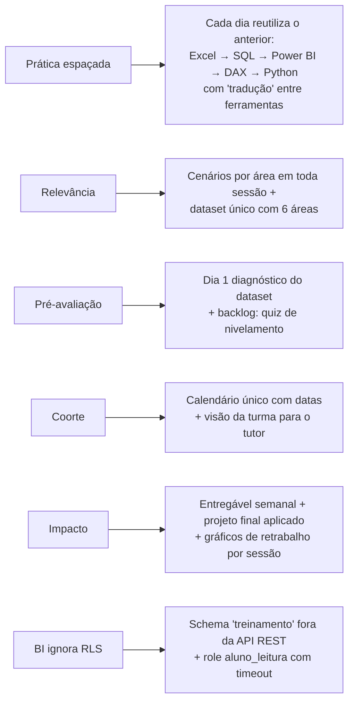

# 🔎 Pesquisa e melhorias aplicadas

## O que a pesquisa trouxe

| Tema | Achado | Fonte |
|---|---|---|
| Retenção | Prática espaçada: ensinar um pedaço, praticar e **aprofundar na sessão seguinte** (camadas). | [DataCamp – hallmarks of successful data training programs](https://www.datacamp.com/podcast/the-hallmarks-of-successful-data-training-programs) |
| Relevância | Treinamento deve usar tópicos **relevantes à operação** da empresa, não só "assuntos de dados". | idem |
| Ponto de partida | **Pré-avaliação** evita repetir o que o aluno já domina. | idem |
| Engajamento | **Coortes** (todos juntos) criam responsabilidade e cultura de aprendizado. | idem |
| Impacto | Piloto pequeno + acompanhar o comportamento semanas depois. | idem |
| Material oficial | A Microsoft publica `.pbix` e `.xlsx` de exemplo e o Desktop tem "Aprender com dados de exemplo". | [Microsoft Learn – sample datasets](https://learn.microsoft.com/power-bi/create-reports/sample-datasets) · [powerbi-desktop-samples](https://github.com/microsoft/powerbi-desktop-samples) |
| Login | Supabase Auth suporta Google via `signInWithOAuth` com `redirectTo` na lista de permitidos. | [Supabase – Login with Google](https://supabase.com/docs/guides/auth/social-login/auth-google) |
| Power BI ↔ Supabase | Guias recomendam pooler de conexão (IPv4), role dedicada **somente leitura** e alertam para erro de certificado SSL; conexões de BI **ignoram RLS** da API. | guias da comunidade (ex.: [DEV – Supabase com Power BI](https://dev.to/jenniekibiri/how-to-connect-supabase-to-microsoft-power-bi-50p8)) – *não oficiais, validar na sua conta* |

> A busca não trouxe fontes rigorosas sobre *mastery learning* e feedback; essas escolhas seguem o consenso geral da área (ver "Decisões de projeto").

## Como cada achado virou requisito

## Decisões de projeto (melhorias sobre o pedido original)

1. **Dataset único e determinístico** (`setseed`) em Supabase *e* Excel: todos os alunos chegam aos mesmos números, o tutor corrige com gabarito.
2. **"Prova real" entre ferramentas**: todo exercício pede conferir Excel × SQL × Power BI × Python (hábito de validação).
3. **IA com revisão obrigatória**: prompts prontos + prompt de revisão de código + exercício "caça aos erros" (dia 26). Alerta de LGPD.
4. **Dependências explícitas e verificadas no banco** (não só escondidas na tela).
5. **Mastery learning**: aprovação ≥ 7, refação ilimitada com feedback, histórico de tentativas.
6. **Rubrica do tutor** com pesos (números 35%, negócio 25%, técnica 20%, visual 10%, reprodutibilidade 10%).
7. **Acessibilidade e mobile**: contraste, navegação por teclado, layout responsivo, modo escuro automático.
8. **Segurança**: RLS em todas as tabelas, aluno não altera currículo, nota ou perfil; tutor definido por allowlist.

## Backlog sugerido (próximas melhorias)

| Prioridade | Item | Motivo |
|---|---|---|
| Alta | Quiz de nivelamento no dia 0 (pular sessões já dominadas) | Pré-avaliação |
| Alta | Notificação por e-mail ao tutor/aluno (Edge Function + Resend) | Reduz tempo de resposta |
| Média | Quizzes curtos de revisão espaçada (D+1, D+3, D+7) | Retenção |
| Média | Upload de arquivos (Supabase Storage) em vez de apenas links | Conveniência |
| Média | Coortes com data de início própria e várias turmas | Escalar o programa |
| Baixa | Certificado em PDF ao concluir os 3 níveis | Motivação |
| Baixa | Rubrica detalhada por critério (5 notas) no formulário do tutor | Feedback mais preciso |
