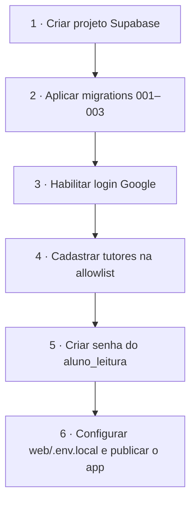

# 🛠️ Setup e recursos



## 1 · Supabase (banco do app **e** banco de análise)

1. Crie um projeto em <https://supabase.com/dashboard> (recomendado: um projeto **dedicado** ao programa).
2. Aplique as migrations **na ordem** (SQL Editor, ou `supabase db push` com a CLI):

| Arquivo | O que faz |
|---|---|
| `supabase/migrations/20261106000001_app_schema.sql` | Tabelas do e-learning, regras de dependência, RLS, triggers |
| `supabase/migrations/20261106000002_training_dataset.sql` | Schema `treinamento` com dados fictícios (≈ 6.900 pedidos, 15 mil itens) + role `aluno_leitura` |
| `supabase/migrations/20261106000003_seed_curriculum.sql` | As 30 sessões, 67 exercícios, templates, recursos (gerado de `content/`) |

3. **URL do projeto:** *Project Settings → API* (`https://<ref>.supabase.co`). É o valor de `VITE_SUPABASE_URL` e o que aparece em *Recursos → Supabase do programa* no app.

## 2 · Login com Google (Gmail)

1. Google Cloud Console → *APIs e serviços → Credenciais* → **ID do cliente OAuth** (tipo *Aplicativo da Web*).
   - Origem JS autorizada: URL do app (ex.: `http://localhost:5173` e a de produção).
   - URI de redirecionamento: `https://<ref>.supabase.co/auth/v1/callback`.
2. Supabase → *Authentication → Providers → Google*: cole Client ID e Secret.
3. Supabase → *Authentication → URL Configuration*: **Site URL** e **Redirect URLs** com a URL do app.
   Guia oficial: <https://supabase.com/docs/guides/auth/social-login/auth-google>.

## 3 · Tutores (perfil professor)

Todo novo login vira **aluno**. Para um e-mail virar **tutor no primeiro login**:

```sql
insert into public.teacher_allowlist (email) values ('tutor@empresa.com');
```

Quem já logou e precisa virar tutor:

```sql
update public.profiles set role = 'teacher' where email = 'tutor@empresa.com';
```

## 4 · Acesso dos alunos aos dados (Power BI, Python, SQL)

O schema `treinamento` **não é exposto pela API REST**. Os alunos entram por conexão Postgres com a role somente-leitura:

```sql
-- execute como administrador, UMA vez (troque a senha; não a versione!)
alter role aluno_leitura with login password '<SENHA-FORTE>';
```

| Campo | Valor |
|---|---|
| Servidor | *Project Settings → Database → Connect* — use o **Session pooler** (IPv4), ex.: `aws-0-<região>.pooler.supabase.com` |
| Porta | `5432` (session pooler) |
| Banco | `postgres` |
| Usuário | `aluno_leitura.<project-ref>` (no pooler) |
| Schema | `treinamento` |
| SSL | obrigatório |

> ⚠️ Os guias de comunidade divergem sobre porta/modo do pooler e citam erro de certificado no Power BI; **valide na sua conta** e, se necessário, importe o certificado raiz exibido em *Database → SSL*. Conexões diretas de BI ignoram RLS — por isso o dataset de treinamento é isolado em schema próprio e sem dados reais.

## 5 · Downloads

| Recurso | Link | Observação |
|---|---|---|
| Dataset em Excel | `web/public/data/dataset_treinamento.xlsx` (no app: Biblioteca) | 8 abas = 8 tabelas do Supabase |
| Power BI Desktop | <https://www.microsoft.com/en-us/download/details.aspx?id=58494> ou Microsoft Store (`aka.ms/pbidesktopstore`) | Somente Windows |
| Exemplos `.pbix` oficiais | <https://github.com/microsoft/powerbi-desktop-samples> · [guia](https://learn.microsoft.com/power-bi/create-reports/sample-datasets) | Para estudo do modelo e visuais |
| Python | <https://www.python.org/downloads/> | 3.12+; marcar *Add to PATH* |
| VS Code | <https://code.visualstudio.com/download> | + extensões Python e Jupyter |
| Bibliotecas | `pip install pandas matplotlib seaborn "psycopg[binary]" sqlalchemy statsmodels openpyxl` | dentro de um `venv` |

## 6 · Sobre os arquivos `.pbix`

Arquivos `.pbix` são binários criados no Power BI Desktop (Windows) e **não são gerados neste repositório**. Em vez disso o toolkit entrega:
- o **roteiro `.pbix`** (`b-pbix-guia`) com páginas, visuais e medidas esperadas — serve de modelo para o aluno e de gabarito para o tutor;
- o **pacote DAX** (`b-dax-pack`);
- os `.pbix` oficiais da Microsoft para estudo.

Se quiser um `.pbix` base, abra o Desktop, conecte ao Supabase, monte as 3 páginas do roteiro e salve em `toolkit/powerbi/` (ou use *Salvar como modelo `.pbit`*).

## 7 · Regenerar o conteúdo

O currículo é escrito em `content/*.mjs` (fonte única). Depois de editar:

```bash
npm install
npm run build:content      # seed SQL + docs + templates
npm run validate:sql       # aplica as 3 migrations num Postgres embutido
node scripts/test-rls.mjs  # testa RLS, dependências e tentativas
```
