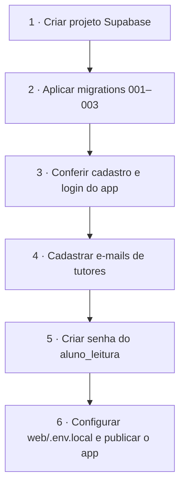
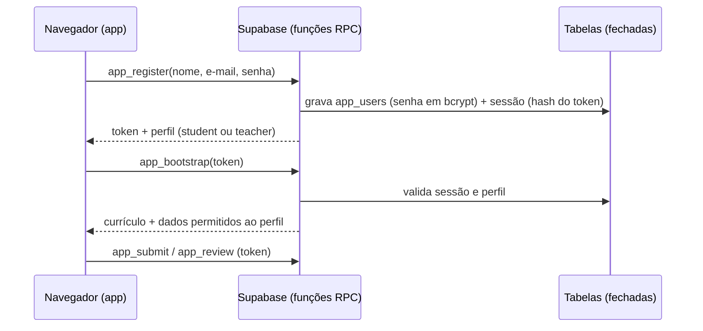

# 🛠️ Setup e recursos



## 1 · Supabase (banco do app **e** banco de análise)

1. Crie um projeto em <https://supabase.com/dashboard> (recomendado: um projeto **dedicado** ao programa).
2. Aplique as migrations **na ordem** (SQL Editor, ou `supabase db push` com a CLI):

| Arquivo | O que faz |
|---|---|
| `supabase/migrations/20261106000001_app_schema.sql` | Schema inicial do e-learning (a parte de login Google foi substituída pela migration 004) |
| `supabase/migrations/20261106000002_training_dataset.sql` | Schema `treinamento` com dados fictícios (≈ 6.900 pedidos, 15 mil itens) + role `aluno_leitura` |
| `supabase/migrations/20261106000003_seed_curriculum.sql` | As 30 sessões, 68 exercícios, templates, recursos (gerado de `content/`) |
| `supabase/migrations/20261106000004_custom_auth.sql` | **Autenticação própria**: `app_users`, sessões, funções RPC e bloqueio de acesso direto às tabelas |
| `supabase/migrations/20261106000005_day9_day10_excel_first.sql` | Atualização idempotente dos dias 9 e 10 (Excel primeiro, Supabase no dia 10). Já incluída no seed para instalações novas |
| `supabase/migrations/20261106000006_signup_invite.sql` | **Cadastro controlado**: modos `open`/`invite`/`closed`, código de convite (guardado só como hash) e função `admin_set_signup` |

> Atalho: `supabase/apply_all.sql` contém as migrations concatenadas — cole no SQL Editor e execute uma vez (regenere com `cat supabase/migrations/*.sql > supabase/apply_all.sql`).

3. **URL do projeto:** *Project Settings → API* (`https://<ref>.supabase.co`). É o valor de `VITE_SUPABASE_URL` e o que aparece em *Recursos → Supabase do programa* no app.

## 2 · Cadastro e login (gerenciados pelo app)

Não há login Google nem Supabase Auth. Os usuários ficam na tabela `public.app_users` (alunos e tutores):



| Item | Como funciona |
|---|---|
| Cadastro | Controlado por modo (ver seção *Controle de cadastro*): por padrão exige **código de convite**; tutores da lista autorizada sempre podem se cadastrar |
| Senha | Guardada com **bcrypt** (pgcrypto); nunca retorna à interface |
| Sessão | Token aleatório de 256 bits; só o hash SHA-256 é gravado; validade de 30 dias; "Sair" invalida |
| Tentativas | Após 5 senhas erradas, a conta fica bloqueada por 10 minutos |
| Acesso aos dados | As tabelas não são acessíveis pela API; só as funções `app_*` (que checam o perfil) |
| Perfis | `student` (vê só os próprios dados) e `teacher` (vê a turma e avalia) |

> ⚠️ **Limite conhecido:** não há recuperação de senha por e-mail nem verificação de e-mail. A redefinição é feita pelo administrador (SQL abaixo).

### Controle de cadastro (turma fechada)

O cadastro tem três modos, definidos no SQL Editor com a função `admin_set_signup` (inacessível pela API pública):

| Modo | Quem consegue criar conta |
|---|---|
| `invite` (padrão) | Quem informar o **código de convite**; tutores da lista autorizada dispensam o código |
| `closed` | Somente e-mails da lista de tutores |
| `open` | Qualquer pessoa (como antes) |

```sql
select public.admin_set_signup('invite', 'NOVO-CODIGO-2026');  -- define/troca o código (mín. 8 caracteres; ignora maiúsculas, espaços e hífens)
select public.admin_set_signup('closed');                      -- fecha o cadastro após a matrícula
select public.admin_set_signup('open');                        -- reabre sem código
```

O código fica salvo apenas como hash SHA-256 em `public.app_settings` (sem acesso pela API). Contas já criadas não são afetadas. Para invalidar um código vazado, troque-o. Distribua o código só pelos canais da coordenação.

## 3 · Tutores (perfil professor)

Todo cadastro vira **aluno**, exceto e-mails da lista de tutores. Cadastre o e-mail **antes** de a pessoa criar a conta:

```sql
insert into public.teacher_allowlist (email) values ('tutor@empresa.com');
```

Quem já se cadastrou como aluno e precisa virar tutor:

```sql
update public.app_users set role = 'teacher' where email = 'tutor@empresa.com';
```

Redefinir a senha de um usuário (como administrador, no SQL Editor):

```sql
update public.app_users
   set password_hash = extensions.crypt('NOVA-SENHA-FORTE', extensions.gen_salt('bf', 10)), failed_attempts = 0, locked_until = null
 where email = 'pessoa@empresa.com';
delete from public.app_sessions where user_id = (select id from public.app_users where email = 'pessoa@empresa.com');
```

## 4 · Acesso dos alunos aos dados (Power BI, Python, SQL)

O schema `treinamento` **não é exposto pela API REST**. Os alunos entram por conexão Postgres com a role somente-leitura:

```sql
-- execute como administrador, UMA vez (troque a senha; não a versione!)
alter role aluno_leitura with login password '<SENHA-FORTE>';
```

| Campo | Valor |
|---|---|
| Servidor | *Project Settings → Database → Connect* — use o **Session pooler** (IPv4), ex.: `aws-0-<região>.pooler.supabase.com` |
| Porta | `5432` (session pooler) |
| Banco | `postgres` |
| Usuário | `aluno_leitura.<project-ref>` (no pooler) |
| Schema | `treinamento` |
| SSL | obrigatório |

> ⚠️ Os guias de comunidade divergem sobre porta/modo do pooler e citam erro de certificado no Power BI; **valide na sua conta** e, se necessário, importe o certificado raiz exibido em *Database → SSL*. Conexões diretas de BI ignoram RLS — por isso o dataset de treinamento é isolado em schema próprio e sem dados reais.

## 5 · Downloads

| Recurso | Link | Observação |
|---|---|---|
| Dataset em Excel | `web/public/data/dataset_treinamento.xlsx` (no app: Biblioteca) | 8 abas = 8 tabelas do Supabase |
| Power BI Desktop | <https://www.microsoft.com/en-us/download/details.aspx?id=58494> ou Microsoft Store (`aka.ms/pbidesktopstore`) | Somente Windows |
| Exemplos `.pbix` oficiais | <https://github.com/microsoft/powerbi-desktop-samples> · [guia](https://learn.microsoft.com/power-bi/create-reports/sample-datasets) | Para estudo do modelo e visuais |
| Python | <https://www.python.org/downloads/> | 3.12+; marcar *Add to PATH* |
| VS Code | <https://code.visualstudio.com/download> | + extensões Python e Jupyter |
| Bibliotecas | `pip install pandas matplotlib seaborn "psycopg[binary]" sqlalchemy statsmodels openpyxl` | dentro de um `venv` |

## 6 · Sobre os arquivos `.pbix`

Arquivos `.pbix` são binários criados no Power BI Desktop (Windows) e **não são gerados neste repositório**. Em vez disso o toolkit entrega:
- o **roteiro `.pbix`** (`b-pbix-guia`) com páginas, visuais e medidas esperadas — serve de modelo para o aluno e de gabarito para o tutor;
- o **pacote DAX** (`b-dax-pack`);
- os `.pbix` oficiais da Microsoft para estudo.

Se quiser um `.pbix` base, abra o Desktop, conecte ao Supabase, monte as 3 páginas do roteiro e salve em `toolkit/powerbi/` (ou use *Salvar como modelo `.pbit`*).

## 7 · Regenerar o conteúdo

O currículo é escrito em `content/*.mjs` (fonte única). Depois de editar:

```bash
npm install
npm run build:content      # seed SQL + docs + templates
npm run validate:sql       # aplica as 3 migrations num Postgres embutido
node scripts/test-auth.mjs # testa cadastro/login, sessões, acesso por perfil, dependências e avaliação
```
