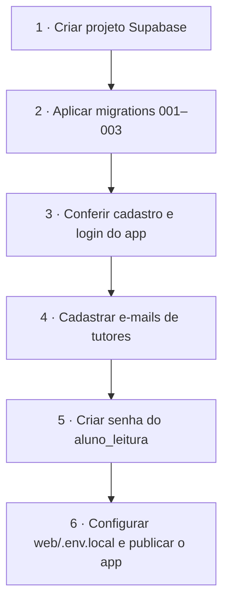
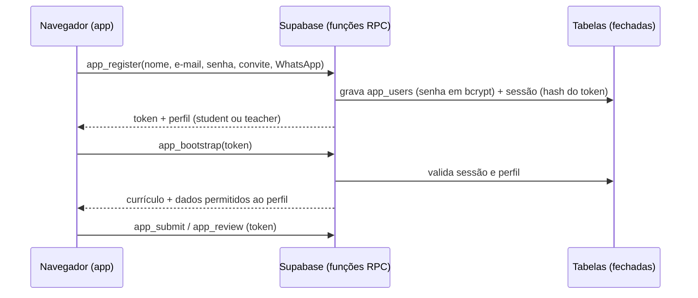

# 🛠️ Setup e recursos



## 1 · Supabase (banco do app **e** banco de análise)

1. Crie um projeto em <https://supabase.com/dashboard> (recomendado: um projeto **dedicado** ao programa).
2. Aplique as migrations **na ordem** (SQL Editor, ou `supabase db push` com a CLI):

| Arquivo | O que faz |
|---|---|
| `supabase/migrations/20261106000001_app_schema.sql` | Schema inicial do e-learning (a parte de login Google foi substituída pela migration 004) |
| `supabase/migrations/20261106000002_training_dataset.sql` | Schema `treinamento` com dados fictícios (≈ 6.900 pedidos, 15 mil itens) + role `aluno_leitura` |
| `supabase/migrations/20261106000003_seed_curriculum.sql` | As 30 sessões, 68 exercícios, templates, recursos (gerado de `content/`) |
| `supabase/migrations/20261106000004_custom_auth.sql` | **Autenticação própria**: `app_users`, sessões, funções RPC e bloqueio de acesso direto às tabelas |
| `supabase/migrations/20261106000005_day9_day10_excel_first.sql` | Atualização idempotente dos dias 9 e 10 (Excel primeiro, Supabase no dia 10). Já incluída no seed para instalações novas |
| `supabase/migrations/20261106000006_signup_invite.sql` | **Cadastro controlado**: modos `open`/`invite`/`closed`, código de convite (guardado só como hash) e função `admin_set_signup` |
| `supabase/migrations/20261106000007_password_reset_and_throttle.sql` | **Redefinição de senha assistida pelo tutor** (código de uso único, 1 h) e **limite de tentativas** do código de convite |
| `supabase/migrations/20261106000008_data_dictionary.sql` | Dicionário de dados: novo template, diagrama ER completo e vínculo aos dias 1, 6, 7, 8 e 11 |
| `supabase/migrations/20261106000015_whatsapp_verification.sql` | **WhatsApp**: telefone obrigatório no cadastro, **verificação do número por código** e **recuperação de senha por WhatsApp** (somam-se ao convite e ao reset do tutor) |
| `supabase/migrations/20261106000016_student_invites.sql` | **Convites personalizados**: o tutor informa nome, e-mail e WhatsApp; o aluno recebe um link por WhatsApp e só define a senha |
| `supabase/migrations/20261106000017_profile_and_roles.sql` | **Perfil editável** (nome, e-mail, WhatsApp, senha), **convite de tutor** e **troca de perfil** aluno ⇄ tutor |

> Atalho para **banco novo**: `supabase/apply_all.sql` contém todas as migrations concatenadas — cole no SQL Editor e execute uma vez (regenere com `cat supabase/migrations/*.sql > supabase/apply_all.sql`). **Só funciona em banco vazio**: num banco já configurado falha com `relation "app_users" already exists`. Para **atualizar** currículo/recursos num banco existente, cole apenas `supabase/migrations/20261106000003_seed_curriculum.sql` (pode ser reaplicado). **Nunca** reaplique a migration 004 num banco com alunos. — cole no SQL Editor e execute uma vez (regenere com `cat supabase/migrations/*.sql > supabase/apply_all.sql`). A correção por IA (Gemini) e os anexos/links têm passos próprios em [06-correcao-ia](06-correcao-ia.md).

3. **URL do projeto:** *Project Settings → API* (`https://<ref>.supabase.co`). É o valor de `VITE_SUPABASE_URL` e o que aparece em *Recursos → Supabase do programa* no app.

## 2 · Cadastro e login (gerenciados pelo app)

Não há login Google nem Supabase Auth. Os usuários ficam na tabela `public.app_users` (alunos e tutores):



| Item | Como funciona |
|---|---|
| Cadastro | Controlado por modo (ver seção *Controle de cadastro*): por padrão exige **código de convite**; tutores da lista autorizada sempre podem se cadastrar |
| Senha | Guardada com **bcrypt** (pgcrypto); nunca retorna à interface |
| Sessão | Token aleatório de 256 bits; só o hash SHA-256 é gravado; validade de 30 dias; "Sair" invalida |
| Tentativas | Após 5 senhas erradas, a conta fica bloqueada por 10 minutos. No cadastro por convite, após 20 códigos errados em 15 minutos o cadastro de alunos pausa por 15 minutos (limite global: protege contra adivinhação, mas um abusador pode atrasar matrículas; se acontecer, troque o código ou use `closed`) |
| Acesso aos dados | As tabelas não são acessíveis pela API; só as funções `app_*` (que checam o perfil) |
| Perfis | `student` (vê só os próprios dados) e `teacher` (vê a turma e avalia) |

> ⚠️ **Limite conhecido:** não há verificação de e-mail. O WhatsApp é verificado por código; a redefinição de senha pode ser por WhatsApp ou assistida pelo tutor (seções abaixo).

### WhatsApp: confirmação de cadastro e recuperação de senha

O cadastro pede o WhatsApp no formato `(99) 99999-9999`. O envio usa a Evolution API (`https://zap.senszia.com`) **pelo servidor** — as funções `web/api/welcome.ts`, `web/api/verify-send.ts` e `web/api/reset-request.ts` (Vercel) — para que a apikey nunca vá ao navegador.

| Variável (Vercel → Settings → Environment Variables, **sem** prefixo `VITE_`) | Valor |
|---|---|
| `EVOLUTION_API_URL` | `https://zap.senszia.com` |
| `EVOLUTION_API_KEY` | apikey da instância |
| `EVOLUTION_INSTANCE` | nome da instância já conectada (QR) |
| `SUPABASE_SERVICE_ROLE_KEY` | *Project Settings → API → service_role* (secreta) |
| `VITE_SUPABASE_URL` | já usada pelo app (o servidor a reaproveita) |

- **Verificação no cadastro:** ao criar a conta, `/api/verify-send` envia um código de 6 dígitos ao número informado. Enquanto o código não for confirmado (`app_verify_confirm`), a conta fica **não verificada** e o servidor recusa currículo, entregas e avaliações (`app_bootstrap`, `app_submit`, `app_review`); o app mostra a tela "Confirme seu WhatsApp" (reenviar código, corrigir número errado, sair). Código: validade 15 min, 5 tentativas, guardado só como hash, 1 envio por minuto. Contas anteriores à migration 006 ficam como verificadas.
- **Boas-vindas:** depois de verificar, o app chama `/api/welcome` com o token; o servidor envia a confirmação de cadastro **uma única vez** por conta.
- **Esqueci minha senha:** `/api/reset-request` gera um código de 6 dígitos (validade 15 min, 5 tentativas, guardado só como hash, 1 pedido por minuto) e envia ao WhatsApp cadastrado. O aluno informa código + nova senha (`app_wa_reset_confirm`); as sessões antigas são encerradas. A resposta é igual exista a conta ou não (não revela e-mails cadastrados).
- As funções que veem telefone/código (`app_verify_issue`, `app_welcome_claim`, `app_wa_reset_issue`) só são executáveis pela `service_role`.
- Contas criadas antes da migration 015 não têm WhatsApp e, por isso, não usam a recuperação por WhatsApp (use o código do tutor ou o SQL abaixo). Para cadastrar o número: `update public.app_users set phone = '5511999998888' where email = '...';`
- Em desenvolvimento local, as rotas `/api/*` exigem `vercel dev` (o `vite` sozinho não as executa).


### Controle de cadastro (turma fechada)

O cadastro tem três modos, definidos no SQL Editor com a função `admin_set_signup` (inacessível pela API pública):

| Modo | Quem consegue criar conta |
|---|---|
| `invite` (padrão) | Quem informar o **código de convite**; tutores da lista autorizada dispensam o código |
| `closed` | Somente e-mails da lista de tutores |
| `open` | Qualquer pessoa (como antes) |

```sql
select public.admin_set_signup('invite', 'NOVO-CODIGO-2026');  -- define/troca o código (mín. 8 caracteres; ignora maiúsculas, espaços e hífens)
select public.admin_set_signup('closed');                      -- fecha o cadastro após a matrícula
select public.admin_set_signup('open');                        -- reabre sem código
```

O código fica salvo apenas como hash SHA-256 em `public.app_settings` (sem acesso pela API). Contas já criadas não são afetadas. Para invalidar um código vazado, troque-o. Distribua o código só pelos canais da coordenação.

### Convites personalizados (Tutor → Convites)

Em **Tutor → Convites**, o tutor informa **nome, e-mail e WhatsApp** do aluno e clica em *Enviar convite por WhatsApp*. O servidor (`web/api/invite-send.ts`) cria o convite e manda ao aluno uma mensagem com o link do app (`https://<seu-app>/?convite=<token>`). Ao abrir o link, o aluno vê os dados já preenchidos, escolhe a **senha**, confirma e a conta é criada — já com o WhatsApp verificado (receber o link comprova o número) e a mensagem de boas-vindas é enviada.

- O link é pessoal, vale **7 dias** e é de **uso único**; só o hash do token fica no banco e o token nunca passa pelo navegador do tutor. *Reenviar* gera um novo link e invalida o anterior; *Cancelar* revoga um convite pendente.
- Vale mesmo com o cadastro **fechado** ou por código geral: o convite personalizado dispensa o código.
- Limite de 30 convites por tutor por hora. Opcional: defina `APP_URL` (ex.: `https://dafa-ehpessoa.vercel.app`) na Vercel para fixar o domínio usado no link; sem ela, usa o domínio da requisição.

### Editar perfil, convidar tutores e trocar perfis

- **Meu perfil:** clicar na foto/nome no menu (ou na foto no topo, no celular) abre a página de edição, para alunos e tutores. Nome é livre; **e-mail e senha exigem a senha atual**; trocar a **senha** desconecta os outros dispositivos. Para trocar o **WhatsApp** é preciso a senha atual e digitar o código enviado ao **novo** número (`/api/phone-change-send`); o número antigo vale até a confirmação.
- **Convidar tutor:** em *Tutor → Convites*, escolha o perfil **Tutor** no formulário. O fluxo é o mesmo do convite de aluno (link no WhatsApp, a pessoa só define a senha).
- **Trocar perfil:** em *Tutor → Alunos → (aluno)* use **Promover a tutor**; na lista **Tutores** (página Alunos) use **Tornar aluno**. Ninguém altera o próprio perfil, então sempre resta ao menos um tutor.

### Esqueci minha senha (redefinição assistida pelo tutor)

Sem e-mail, a redefinição passa pelo tutor:

1. Em **Tutor → Alunos → (aluno)**, o tutor clica em **Gerar código de redefinição**. O código (ex.: `ABCD-2345`) vale **1 hora** e é de **uso único**; gerar outro invalida o anterior. Tutores só geram código para alunos, nunca para outros tutores.
2. O tutor envia o código ao aluno por um canal seguro.
3. Na tela de login, o aluno usa **Esqueci minha senha → Tenho um código do tutor**, informa e-mail, código e a nova senha. As sessões antigas são encerradas.

Após 5 códigos errados, o código é descartado e é preciso gerar outro. O SQL manual da seção seguinte continua valendo para o caso de um tutor esquecer a própria senha.

## 3 · Tutores (perfil professor)

Todo cadastro vira **aluno**, exceto e-mails da lista de tutores. Cadastre o e-mail **antes** de a pessoa criar a conta:

```sql
insert into public.teacher_allowlist (email) values ('tutor@empresa.com');
```

Quem já se cadastrou como aluno e precisa virar tutor:

```sql
update public.app_users set role = 'teacher' where email = 'tutor@empresa.com';
```

Redefinir a senha de um usuário (como administrador, no SQL Editor):

```sql
update public.app_users
   set password_hash = extensions.crypt('NOVA-SENHA-FORTE', extensions.gen_salt('bf', 10)), failed_attempts = 0, locked_until = null
 where email = 'pessoa@empresa.com';
delete from public.app_sessions where user_id = (select id from public.app_users where email = 'pessoa@empresa.com');
```

## 4 · Acesso dos alunos aos dados (Power BI, Python, SQL)

O schema `treinamento` **não é exposto pela API REST**. Os alunos entram por conexão Postgres com a role somente-leitura:

```sql
-- execute como administrador, UMA vez (troque a senha; não a versione!)
alter role aluno_leitura with login password '<SENHA-FORTE>';
```

| Campo | Valor |
|---|---|
| Servidor | *Project Settings → Database → Connect* — use o **Session pooler** (IPv4), ex.: `aws-0-<região>.pooler.supabase.com` |
| Porta | `5432` (session pooler) |
| Banco | `postgres` |
| Usuário | `aluno_leitura.<project-ref>` (no pooler) |
| Schema | `treinamento` |
| SSL | obrigatório |

> 👤 **Alunos não usam o painel do Supabase** (exigiria convidá-los por e-mail para a organização). Eles consultam com um cliente SQL gratuito (DBeaver) e este usuário; o passo a passo está no template `c-conexao-banco` ("Guia: conectar ao banco"), vinculado ao Dia 6. Compartilhe host, usuário e senha por um canal da turma, nunca no repositório.

> ⚠️ Os guias de comunidade divergem sobre porta/modo do pooler e citam erro de certificado no Power BI; **valide na sua conta** e, se necessário, importe o certificado raiz exibido em *Database → SSL*. Conexões diretas de BI ignoram RLS — por isso o dataset de treinamento é isolado em schema próprio e sem dados reais.

## 5 · Downloads

| Recurso | Link | Observação |
|---|---|---|
| Dataset em Excel | `web/public/data/dataset_treinamento.xlsx` (no app: Biblioteca) | 8 abas = 8 tabelas do Supabase, mais a aba `DICIONARIO` |
| Dicionário de dados | `web/public/templates/dicionario-dados.xlsx` · [docs/dicionario-de-dados.md](dicionario-de-dados.md) | Colunas, valores possíveis, relações e cuidados de cálculo (fonte: `content/dicionario.json`) |
| Power BI Desktop | <https://www.microsoft.com/en-us/download/details.aspx?id=58494> ou Microsoft Store (`aka.ms/pbidesktopstore`) | Somente Windows |
| Exemplos `.pbix` oficiais | <https://github.com/microsoft/powerbi-desktop-samples> · [guia](https://learn.microsoft.com/power-bi/create-reports/sample-datasets) | Para estudo do modelo e visuais |
| Python | <https://www.python.org/downloads/> | 3.12+; marcar *Add to PATH* |
| VS Code | <https://code.visualstudio.com/download> | + extensões Python e Jupyter |
| Bibliotecas | `pip install pandas matplotlib seaborn "psycopg[binary]" sqlalchemy statsmodels openpyxl` | dentro de um `venv` |

## 6 · Sobre os arquivos `.pbix`

Arquivos `.pbix` são binários criados no Power BI Desktop (Windows) e **não são gerados neste repositório**. Em vez disso o toolkit entrega:
- o **roteiro `.pbix`** (`b-pbix-guia`) com páginas, visuais e medidas esperadas — serve de modelo para o aluno e de gabarito para o tutor;
- o **pacote DAX** (`b-dax-pack`);
- os `.pbix` oficiais da Microsoft para estudo.

Se quiser um `.pbix` base, abra o Desktop, conecte ao Supabase, monte as 3 páginas do roteiro e salve em `toolkit/powerbi/` (ou use *Salvar como modelo `.pbit`*).

## 7 · Regenerar o conteúdo

O currículo é escrito em `content/*.mjs` (fonte única). Depois de editar:

```bash
npm install
npm run build:content      # seed SQL + docs + templates (inclui docs/dicionario-de-dados.md)
python3 scripts/build_dicionario.py   # Excel do dicionário e aba DICIONARIO no dataset (depois de build_excel.py)
npm run validate:sql       # aplica as 3 migrations num Postgres embutido
node scripts/test-auth.mjs # testa cadastro/login, sessões, acesso por perfil, dependências e avaliação
```
