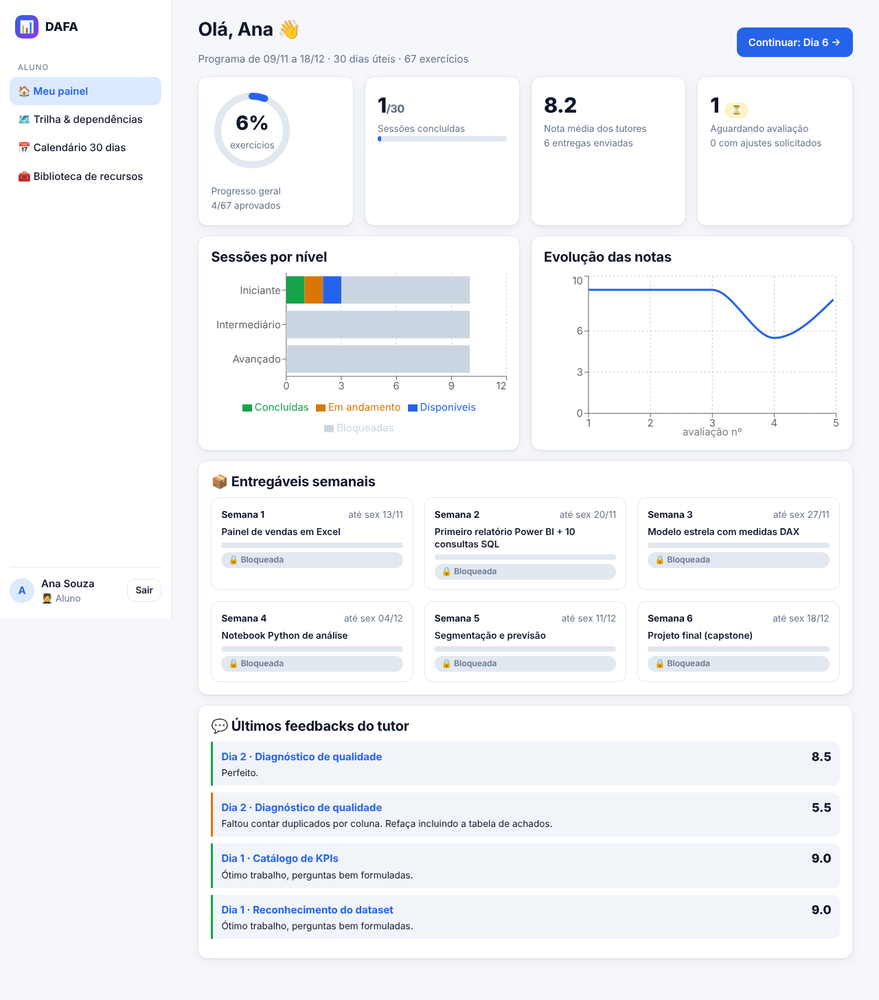
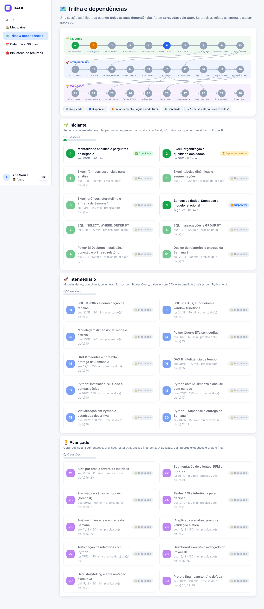
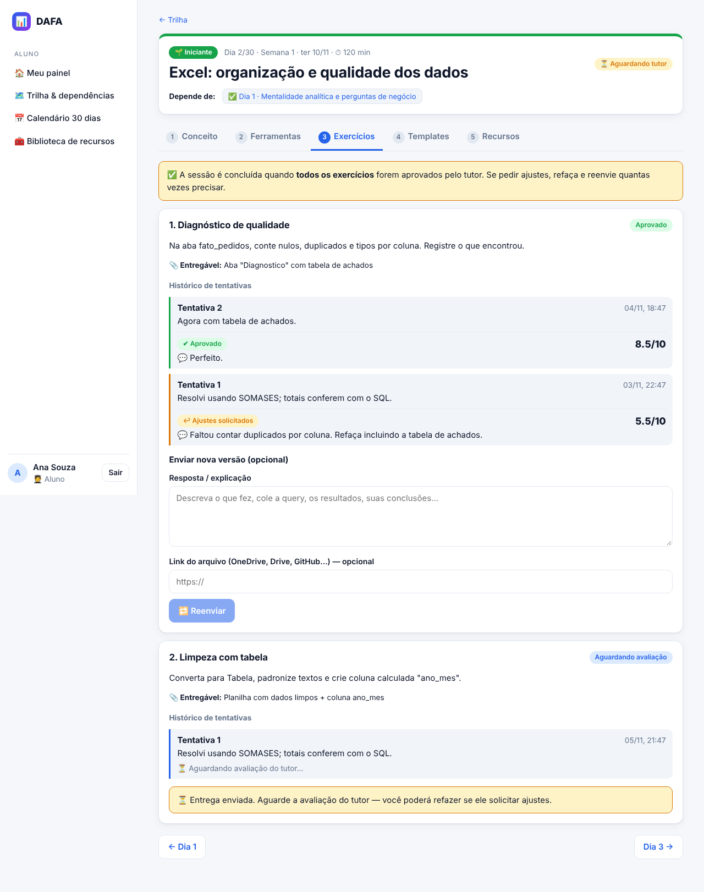
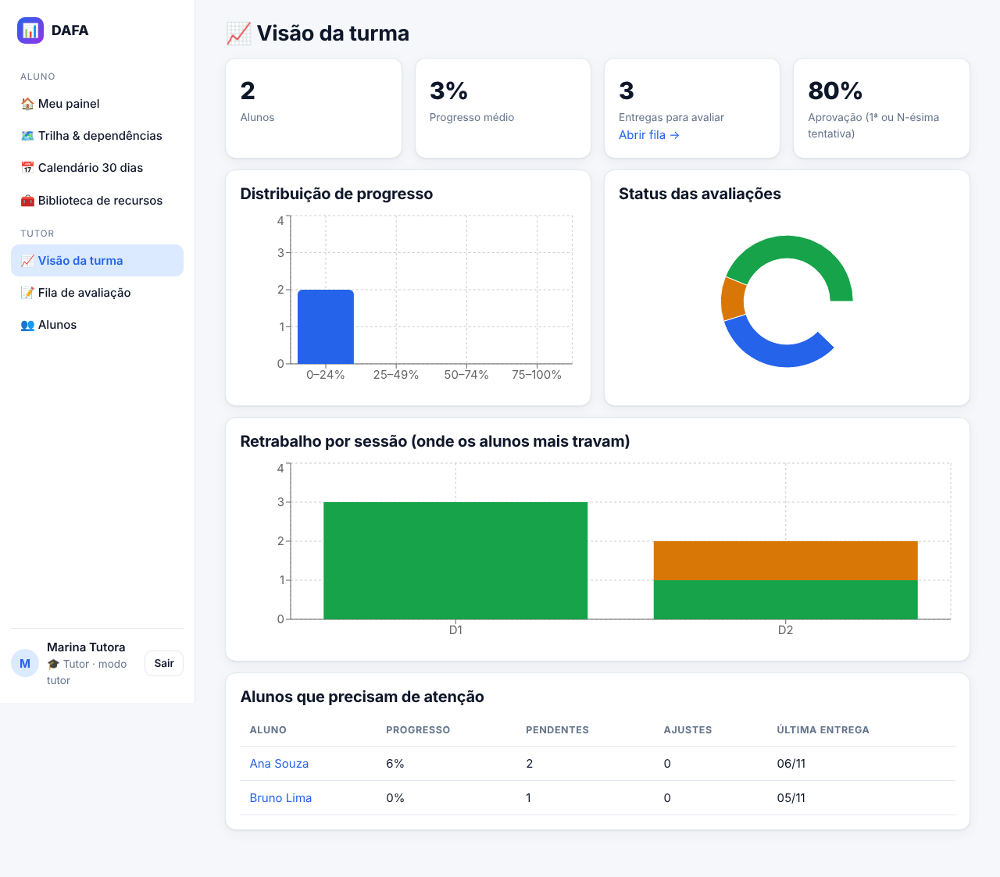
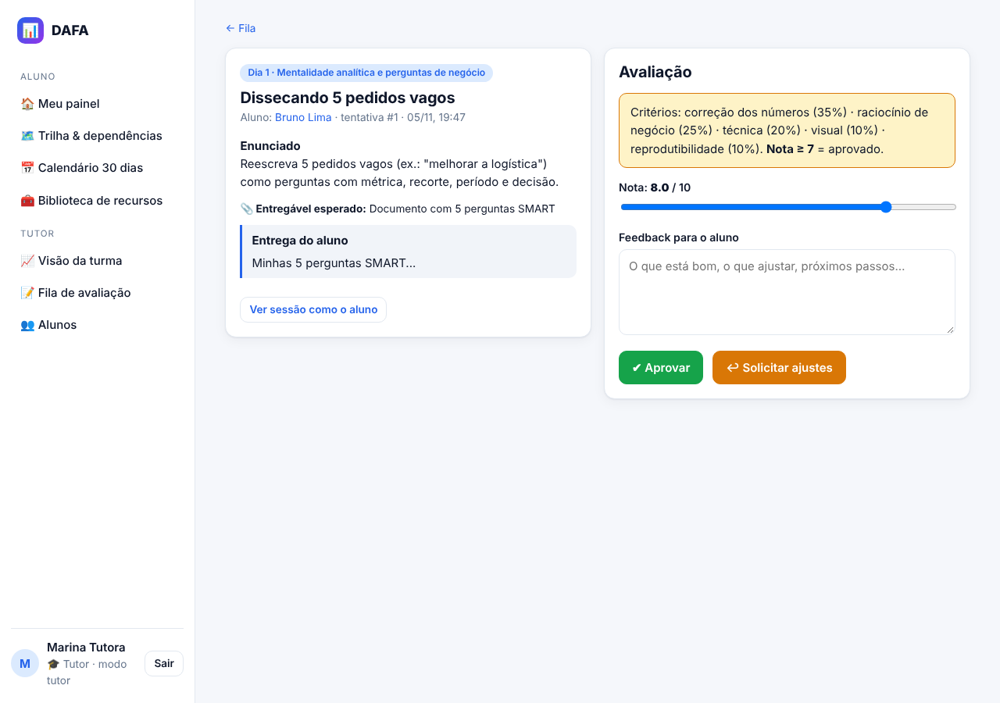
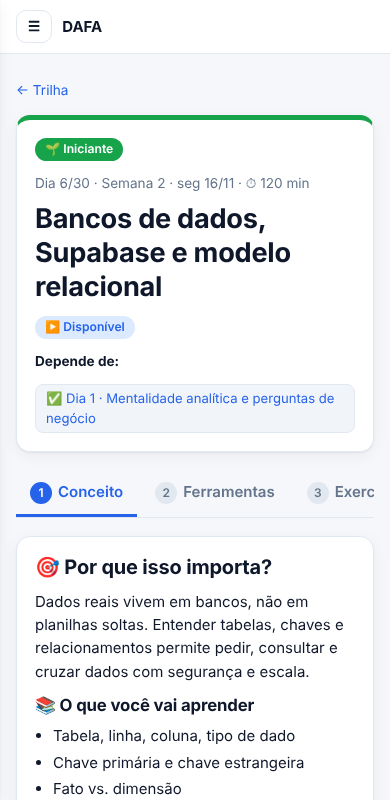
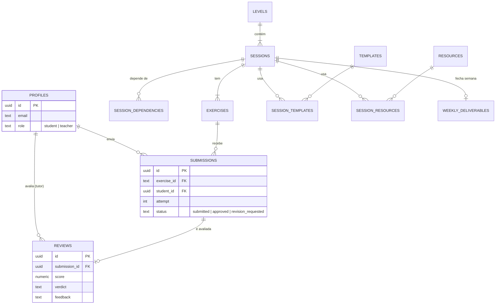

# 💻 App de treinamento (React + Supabase)



## Stack
React 18 · TypeScript · Vite · React Router · Recharts · Mermaid (diagramas, carga sob demanda) · Supabase (Auth Google, Postgres, RLS).

## Perfis e telas

| Perfil | Telas |
|---|---|
| 🧑‍🎓 **Aluno** | Painel (progresso, notas, feedbacks, entregáveis) · Trilha & dependências · Calendário 30 dias · Sessão (5 abas) · Biblioteca |
| 🎓 **Tutor** | Visão da turma (gráficos) · Fila de avaliação · Avaliar (nota 0–10, feedback, aprovar/ajustes) · Alunos · Detalhe do aluno (mapa de progresso) · pré-visualiza qualquer sessão |

| Trilha & dependências | Exercícios com histórico e refação |
|---|---|
|  |  |

| Visão do tutor | Avaliação | Mobile |
|---|---|---|
|  |  |  |

## Modelo de dados do app



## Regras e segurança (no banco)

| Regra | Implementação |
|---|---|
| Só autenticados leem o currículo; só tutor edita | RLS por tabela |
| Aluno só vê as próprias entregas/avaliações; tutor vê todas | RLS em `submissions`, `reviews`, `profiles` |
| Sessão bloqueada não aceita entrega | trigger `before_submission_insert` + `session_unlocked()` |
| Tentativa numerada no servidor; status inicial forçado | mesmo trigger (o aluno não forja `approved`) |
| Só tutor avalia; avaliação atualiza o status da entrega | triggers em `reviews` |
| Aluno não vira tutor | sem `UPDATE` em `profiles` para alunos; tutor via allowlist |
| `anon` sem acesso | `revoke all` + RLS |

## Rodar localmente

```bash
cd web
cp .env.example .env.local     # preencha VITE_SUPABASE_URL e VITE_SUPABASE_ANON_KEY
npm install
npm run dev                    # http://localhost:5173
npm run build                  # typecheck + build de produção
```

Deploy estático (Vercel/Netlify/Cloudflare Pages): `web/vercel.json` e `web/public/_redirects` já fazem o fallback de SPA. Cadastre a URL final em *Supabase → Authentication → URL Configuration*.

## Como foi testado

| Teste | Comando | Cobre |
|---|---|---|
| SQL | `npm run validate:sql` | 3 migrations num Postgres embutido (PGlite) |
| Regras/RLS | `node scripts/test-rls.mjs` | bloqueio por dependência, tentativas, avaliação, isolamento entre alunos, anon |
| UI (E2E) | `node scripts/e2e-mock.mjs` | Playwright com API Supabase **simulada**: aluno, tutor, bloqueio, refazer, mobile, redirecionamento |

> O login Google real e a conexão a um projeto Supabase real dependem das suas credenciais e **não foram exercitados** aqui.
