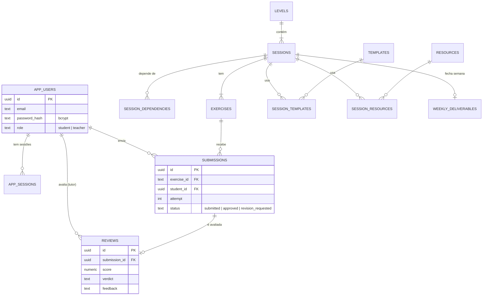
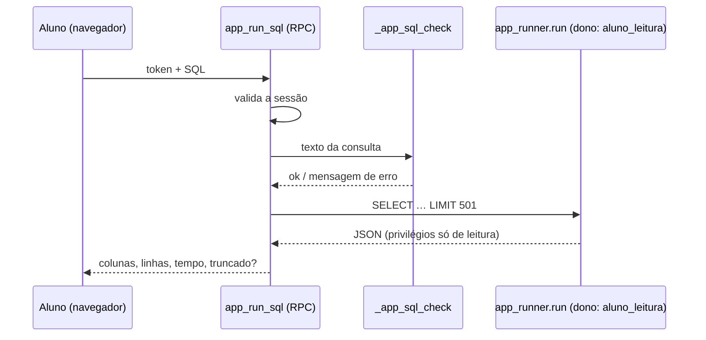

# 💻 App de treinamento (React + Supabase)


## Stack
React 18 · TypeScript · Vite · React Router · Recharts · Mermaid (diagramas, carga sob demanda) · Supabase (Postgres + funções RPC; autenticação própria por e-mail e senha).

## Perfis e telas

| Perfil | Telas |
|---|---|
| 🧑‍🎓 **Aluno** | Painel (progresso, notas, feedbacks, entregáveis) · Trilha & dependências · Calendário 30 dias · Sessão (5 abas) · Biblioteca · **Editor SQL** |
| 🎓 **Tutor** | Visão da turma (gráficos) · Fila de avaliação · Avaliar (nota 0–10, feedback, aprovar/ajustes) · Alunos · Detalhe do aluno (mapa de progresso) · pré-visualiza qualquer sessão |

| Trilha & dependências | Exercícios com histórico e refação |
|---|---|
|  |  |

| Visão do tutor | Avaliação | Mobile |
|---|---|---|
|  |  |  |

## Modelo de dados do app



## Editor SQL

Tela `/sql` (menu **🧮 Editor SQL**): o aluno escreve a consulta, executa com **Ctrl/⌘ + Enter** (a seleção, ou a instrução sob o cursor) e vê a tabela de resultado (até 500 linhas, exporta CSV). Painel lateral com as tabelas e colunas do schema `treinamento` (clique insere o nome; 👁 insere `SELECT * … LIMIT 20`) e seletor para carregar qualquer template SQL da biblioteca. O rascunho fica salvo no navegador. Não usa nenhuma credencial do banco: só a sessão do app.



> ⚠️ Limites: a proteção contra SQL arbitrário é em camadas (validação do texto + role sem permissão de escrita + schema fechado). Consultas pesadas são limitadas pelo `statement_timeout` da role de API do Supabase (3 s por padrão para `anon`); como o dataset é pequeno (≈ 7 mil pedidos) isso basta. Não há limite de consultas por minuto por aluno.

## Regras e segurança (no banco)

| Regra | Implementação |
|---|---|
| Cadastro e login próprios | `app_register`, `app_login`, `app_logout`, `app_me` (tabela `app_users`, bcrypt, sessões com token) |
| Nenhuma tabela é lida/escrita direto pela API | RLS ativo sem policies + `revoke` para `anon`/`authenticated` |
| Aluno só vê as próprias entregas/avaliações; tutor vê a turma | `app_bootstrap` filtra por perfil |
| Sessão bloqueada não aceita entrega | `app_submit` verifica as dependências no servidor |
| Tentativa numerada no servidor; status inicial forçado | `app_submit` (o aluno não forja `approved`) |
| Só tutor avalia; avaliação atualiza o status da entrega | `app_review` |
| Links de entrega só `http(s)` | validação em `app_submit` + `check` na tabela |
| Aluno não vira tutor | papel definido no cadastro (allowlist) ou por SQL do administrador |
| Funções internas não expostas | `_app_*` e `_session_*` sem `execute` para a API |
| Editor SQL só lê o schema `treinamento` | `app_run_sql` valida o texto (1 instrução SELECT/WITH/VALUES/TABLE, sem `;` no meio, parênteses balanceados, sem `$`, sem `INTO`/`SET_CONFIG`/`QUERY_TO_XML`…) e executa em `app_runner.run`, função cujo **dono é a role `aluno_leitura`** (só `SELECT` em `treinamento`; sem acesso a `app_users`, `app_sessions` etc.). Máx. 500 linhas, 20.000 caracteres e 4 MB de resposta |

## Rodar localmente

```bash
cd web
cp .env.example .env.local     # preencha VITE_SUPABASE_URL e VITE_SUPABASE_ANON_KEY
npm install
npm run dev                    # http://localhost:5173
npm run build                  # typecheck + build de produção
```

Deploy estático (Vercel/Netlify/Cloudflare Pages): `web/vercel.json` e `web/public/_redirects` já fazem o fallback de SPA. Cadastre a URL final em *Supabase → Authentication → URL Configuration*.

## Como foi testado

| Teste | Comando | Cobre |
|---|---|---|
| SQL | `npm run validate:sql` | Todas as migrations num Postgres embutido (PGlite) |
| Autenticação e regras | `node scripts/test-auth.mjs` | cadastro/login, bloqueio por tentativas, sessões, isolamento entre alunos, dependências, avaliação, acesso direto negado |
| Editor SQL (banco) | `node scripts/test-sql-runner.mjs` | consultas válidas, limite de 500 linhas, erros, bloqueio de escrita/DDL, acesso às tabelas do app negado, tentativas de injeção (`;`, aspas, comentários, parênteses, `SET_CONFIG`, `QUERY_TO_XML`…), sessão obrigatória, executor interno inacessível à API |
| Editor SQL (front) | `node scripts/test-sql-split.mjs` | divisão do script em instruções, instrução sob o cursor, CSV |
| UI (E2E) | `node scripts/e2e-mock.mjs` | Playwright com API Supabase **simulada**: aluno, tutor, bloqueio, refazer, mobile, redirecionamento |

> O banco real do projeto recebeu um teste de fumaça (cadastro, login, carga de dados e bloqueios) e o usuário de teste foi removido; o fluxo completo na interface publicada deve ser conferido por você após o deploy.
