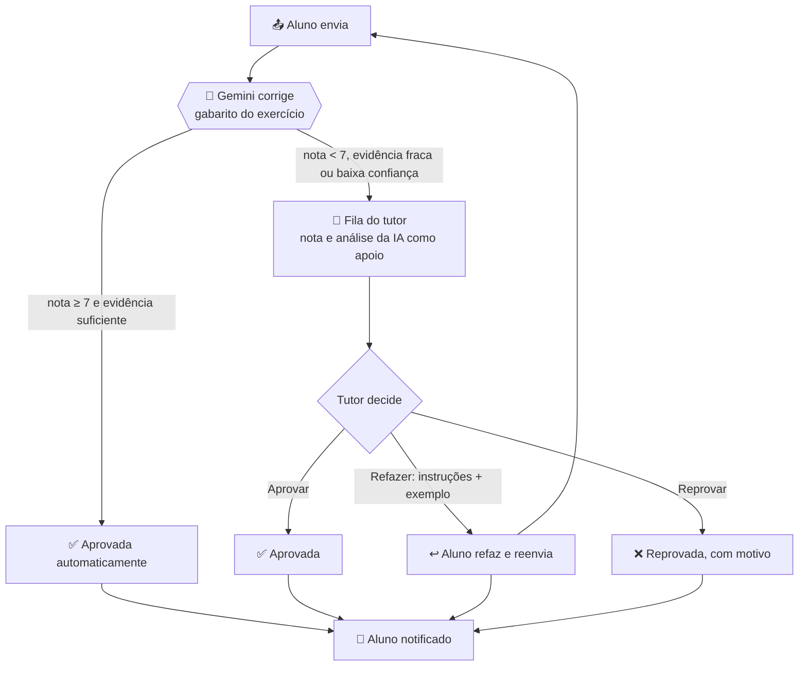

# 🤖 Correção automática por IA (Gemini) + revisão do tutor

> Gerado por `npm run build:content` a partir de `content/rubrics.mjs`. A **nota ≥ 7** aprova sozinha; abaixo disso a entrega vai para o tutor. **Entregas com arquivo têm só pré-análise da IA: a decisão final é sempre do tutor.**

## Fluxo



## Como a nota é calculada

Cada exercício tem de 3 a 5 **verificações** com peso (somam 100). A IA dá 0–10 a cada uma, com comentário; a **nota final é a média ponderada calculada no código** (não é o número que o modelo "acha"). Dimensões: `num` Correção dos números · `neg` Raciocínio de negócio · `tec` Técnica e boas práticas · `vis` Comunicação visual · `rep` Reprodutibilidade.

**Aprovação automática** exige, ao mesmo tempo: nota ≥ 7 · evidência textual suficiente · confiança média/alta · nenhum sinal de tentativa de manipular a IA · exercício que não seja só-tutor · **análise que não dependa de arquivo/link lido** (esses sempre vão ao tutor). Caso contrário vai para o tutor (o motivo fica registrado).

| Tipo de exercício | O que a IA faz |
|---|---|
| `text` | Corrige tudo: a resposta escrita é o entregável. Nota ≥ 7 aprova sozinha |
| `sql` | Query e resultados colados, conferidos contra os **números de referência** do banco de treinamento. Nota ≥ 7 aprova sozinha |
| `file` | **Pré-análise**: lê o arquivo pelo link (Excel, Python/notebook, SQL, DAX/Power BI, slides, PDF, imagens) e dá nota, mas a **decisão final é sempre do tutor** |

## Solução esperada por exercício

### Dia 1 · Mentalidade analítica e perguntas de negócio

**d01-e1 — Dissecando 5 pedidos vagos** 📝 `text`  
_Pedido:_ Reescreva 5 pedidos vagos (ex.: "melhorar a logística") como perguntas com métrica, recorte, período e decisão.  
_Solução esperada:_ Cinco pedidos vagos reescritos como perguntas SMART. Cada pergunta traz métrica, recorte (segmento/canal/região), período e a decisão que a resposta apoia. Ex.: "melhorar a logística" → "Qual transportadora teve o maior % de entregas atrasadas nos últimos 6 meses por UF, para decidir onde renegociar contrato?".

| Peso | Verificação | Dimensão |
|---:|---|---|
| 30 | São 5 perguntas, todas reescritas a partir de pedidos vagos | neg |
| 30 | Cada pergunta tem métrica explícita e mensurável | neg |
| 20 | Cada pergunta tem recorte e período definidos | neg |
| 20 | Cada pergunta indica a decisão/ação que a resposta apoia | neg |

**d01-e2 — Reconhecimento do dataset** 📝 `text`  
_Pedido:_ Abra o Excel do treinamento, descreva em 1 linha cada aba e a granularidade (o que representa uma linha).  
_Solução esperada:_ Tabela com uma linha por aba do Excel de treinamento (dim_clientes, dim_produtos, fato_pedidos, fato_itens_pedido, fato_entregas, fato_campanhas, fato_financeiro, esporte_partidas) com a granularidade correta (ex.: fato_pedidos = 1 linha por pedido; fato_itens_pedido = 1 linha por item de pedido) e 2 perguntas possíveis por aba.

| Peso | Verificação | Dimensão |
|---:|---|---|
| 35 | Cobre todas (ou quase todas) as abas do dataset | num |
| 35 | Granularidade correta e específica ("1 linha = 1 …"), não genérica | num |
| 30 | Duas perguntas plausíveis e respondíveis com os dados da aba | neg |

**d01-e3 — Catálogo de KPIs** 📝 `text`  
_Pedido:_ Escolha 2 áreas (ex.: Comercial e Logística) e liste 4 KPIs de cada com fórmula e fonte.  
_Solução esperada:_ Duas áreas com 4 KPIs cada (8 no total). Cada KPI tem fórmula clara (numerador/denominador) e fonte de dados (tabela/coluna). Ex.: Logística — % entregas no prazo = entregas com data_entrega ≤ data_envio+prazo ÷ entregas, fonte fato_entregas.

| Peso | Verificação | Dimensão |
|---:|---|---|
| 30 | 8 KPIs (4 por área), de 2 áreas distintas | num |
| 30 | Fórmula correta e inequívoca para cada KPI | tec |
| 20 | Fonte (tabela/coluna) indicada e existente no dataset | rep |
| 20 | KPIs relevantes para a área, não duplicados | neg |

### Dia 2 · Excel: organização e qualidade dos dados

**d02-e1 — Diagnóstico de qualidade** 📝 `text`  
_Pedido:_ Na aba fato_pedidos, conte nulos, duplicados e tipos por coluna. Registre o que encontrou.  
_Solução esperada:_ Diagnóstico de qualidade da aba fato_pedidos: contagem de nulos, duplicados e tipos por coluna, registrados numa tabela de achados. O dataset oficial tem 6.900 pedidos, sem IDs duplicados e sem nulos nas colunas principais; o aluno deve reportar o que de fato encontrou (e, se não há problema, dizer isso explicitamente) e como contou.

| Peso | Verificação | Dimensão |
|---:|---|---|
| 40 | Reporta linhas, nulos, duplicados e tipos por coluna, coerentes com a referência | num |
| 25 | Método de contagem descrito (fórmula, filtro ou tabela dinâmica) | rep |
| 20 | Achados organizados numa tabela legível | vis |
| 15 | Indica ação para cada problema (ou conclui que não há) | neg |

_Referência:_ `d02-e1` (ver `content/references.mjs`)

**d02-e2 — Limpeza com tabela** 📎 `file`  
_Pedido:_ Converta para Tabela, padronize textos e crie coluna calculada "ano_mes".  
_Solução esperada:_ Dados convertidos em Tabela do Excel (Ctrl+T), textos padronizados (TRIM/MAIÚSCULAS/PRI.MAIÚSCULA, sem espaços extras) e coluna calculada ano_mes (ex.: =TEXTO([@data_pedido];"aaaa-mm")). O aluno descreve os passos e a fórmula usada.

| Peso | Verificação | Dimensão |
|---:|---|---|
| 30 | Menciona conversão para Tabela do Excel | tec |
| 30 | Padronização de texto descrita (TRIM/maiúsculas etc.) com exemplo antes/depois | tec |
| 30 | Fórmula de ano_mes correta e aplicada à coluna inteira | num |
| 10 | Link ou arquivo da planilha informado | rep |

### Dia 3 · Excel: fórmulas essenciais para análise

**d03-e1 — Receita por canal e status** 📝 `text`  
_Pedido:_ Calcule com SOMASES a receita por canal (exclua cancelados).  
_Solução esperada:_ Receita por canal com SOMASES, excluindo cancelados, usando valor do item (quantidade × preço unitário). Referência (itens, sem cancelados): site 1.532.588,65 · app 1.081.912,01 · marketplace 705.696,63 · loja 361.967,57. Aceitar variação se o aluno documentar outra definição de receita (ex.: incluir frete).

| Peso | Verificação | Dimensão |
|---:|---|---|
| 45 | Valores por canal conferem com a referência (tolerância 1%) ou usam definição alternativa documentada | num |
| 25 | Cancelados excluídos (critério do SOMASES visível) | tec |
| 15 | Fórmula SOMASES apresentada | tec |
| 15 | Tabela de resultados clara, na aba Calculos | vis |

_Referência:_ `d03-e1` (ver `content/references.mjs`)

**d03-e2 — PROCX de produtos** 📎 `file`  
_Pedido:_ Traga categoria e custo de dim_produtos para os itens e calcule a margem por item.  
_Solução esperada:_ Coluna de margem por item via PROCX/XLOOKUP em dim_produtos trazendo categoria e custo; margem = (preço_unitário − custo) × quantidade (ou %). Conferência sugerida: margem total ≈ 36,6% sobre a receita (sem cancelados).

| Peso | Verificação | Dimensão |
|---:|---|---|
| 35 | PROCX/XLOOKUP correto (chave produto_id, retorno categoria e custo) | tec |
| 35 | Fórmula de margem correta (unitária ou total) com custo × quantidade | num |
| 20 | Margem total/percentual coerente com a referência | num |
| 10 | Sem erros #N/D e fórmula copiada para toda a coluna | rep |

_Referência:_ `d03-e2` (ver `content/references.mjs`)

**d03-e3 — Taxa de atraso** 📝 `text`  
_Pedido:_ Calcule % de entregas com atraso por transportadora.  
_Solução esperada:_ % de entregas com atraso por transportadora = entregas com (data_entrega − data_envio) > prazo_dias ÷ entregas entregues. Referência: CargaMais 24,1% · TransBrasil 15,7% · EntregaJá 10,7% · RápidoLog 5,4%.

| Peso | Verificação | Dimensão |
|---:|---|---|
| 50 | Percentuais por transportadora conferem com a referência (±0,5 p.p.) | num |
| 25 | Fórmula de atraso mostrada e correta (compara dias de entrega com prazo) | tec |
| 15 | Considera apenas entregas já realizadas (data_entrega preenchida) | tec |
| 10 | Tabela legível com a transportadora pior destacada | vis |

_Referência:_ `d03-e3` (ver `content/references.mjs`)

### Dia 4 · Excel: tabelas dinâmicas e segmentações

**d04-e1 — Tabela dinâmica de receita** 📎 `file`  
_Pedido:_ Monte receita por mês x categoria com % do total da linha.  
_Solução esperada:_ Tabela dinâmica de receita com linhas = mês, colunas = categoria, valor = soma da receita e uma segunda exibição "% do total da linha". O aluno descreve campos usados e cola/descreve o resultado.

| Peso | Verificação | Dimensão |
|---:|---|---|
| 30 | Campos corretos: mês nas linhas, categoria nas colunas, soma de receita | tec |
| 30 | % do total da linha configurado (Mostrar valores como) | tec |
| 25 | Resultado coerente (cada linha soma 100%; categoria líder = Eletrônicos) | num |
| 15 | Aba Dinamica identificada / arquivo informado | rep |

**d04-e2 — Perguntas rápidas** 📝 `text`  
_Pedido:_ Responda: top 5 UF por receita; mês de pico; canal com maior ticket médio.  
_Solução esperada:_ Respostas: top 5 UF por receita — SP 1.165.347 · RJ 358.071 · MG 344.811 · PR 342.126 · DF 320.493; mês de pico — nov/2025 (≈287.803); canal com maior ticket médio — site (≈568,26; diferenças entre canais são pequenas). Com print/descrição da dinâmica.

| Peso | Verificação | Dimensão |
|---:|---|---|
| 40 | Top 5 UF corretas e na ordem | num |
| 25 | Mês de pico correto | num |
| 20 | Canal de maior ticket médio correto (ticket = receita ÷ pedidos) | num |
| 15 | Evidência da dinâmica (print ou descrição dos campos) | rep |

_Referência:_ `d04-e2`, `d04-e2b`, `d04-e2c` (ver `content/references.mjs`)

### Dia 5 · Excel: gráficos, storytelling e entrega da Semana 1

**d05-e1 — 4 gráficos que respondem a 3 perguntas** 📎 `file`  
_Pedido:_ Crie 4 gráficos com título-conclusão no painel.  
_Solução esperada:_ Painel com 4 gráficos que respondem a 3 perguntas de negócio; cada gráfico com título-conclusão (ex.: "Eletrônicos geram 46% da receita"), eixos legíveis, sem excesso de cores. O aluno lista as 3 perguntas e o título de cada gráfico.

| Peso | Verificação | Dimensão |
|---:|---|---|
| 25 | Quatro gráficos descritos, vinculados a 3 perguntas explícitas | neg |
| 30 | Títulos são conclusões (afirmam o insight), não rótulos | vis |
| 20 | Tipo de gráfico adequado a cada pergunta | vis |
| 15 | Insights consistentes com os dados (ex.: SP lidera, pico em nov) | num |
| 10 | Arquivo/aba Painel informado | rep |

**d05-e2 — Relatório de entrega** 📝 `text`  
_Pedido:_ Escreva o relatório seguindo o modelo (pergunta, método, 3 achados, recomendação).  
_Solução esperada:_ Relatório no modelo de entrega semanal: pergunta, método, 3 achados quantificados, recomendação acionável e limitações. Linguagem executiva, curto.

| Peso | Verificação | Dimensão |
|---:|---|---|
| 20 | Pergunta de negócio clara | neg |
| 20 | Método descrito de forma reproduzível | rep |
| 30 | Três achados com números | num |
| 20 | Recomendação concreta ligada aos achados | neg |
| 10 | Organização e clareza do texto | vis |

### Dia 6 · Bancos de dados, Supabase e modelo relacional

**d06-e1 — Ler o diagrama ER** 📝 `text`  
_Pedido:_ Identifique PK/FK e cardinalidade de cada relacionamento.  
_Solução esperada:_ Tabela com cada relacionamento do ER: PK de cada tabela e FK correspondente, com cardinalidade 1:N. Ex.: dim_clientes.cliente_id (PK) 1—N fato_pedidos.cliente_id (FK); fato_pedidos 1—N fato_itens_pedido; dim_produtos 1—N fato_itens_pedido; fato_pedidos 1—1 fato_entregas.

| Peso | Verificação | Dimensão |
|---:|---|---|
| 40 | PKs corretas para todas as tabelas | num |
| 40 | FKs e cardinalidades corretas | num |
| 20 | Organização em tabela clara | vis |

**d06-e2 — Primeiro acesso** 📝 `text`  
_Pedido:_ Conecte-se ao Supabase e rode SELECT COUNT(*) em cada tabela.  
_Solução esperada:_ SELECT COUNT(*) em cada tabela com as contagens: dim_clientes 800 · dim_produtos 60 · fato_pedidos 6.900 · fato_itens_pedido 14.994 · fato_entregas 6.514 · fato_campanhas 120 · fato_financeiro 192 · esporte_partidas 760.

| Peso | Verificação | Dimensão |
|---:|---|---|
| 70 | Contagens conferem com a referência | num |
| 15 | Mostra a(s) query(s) usada(s) | rep |
| 15 | Apresenta em tabela/print legível | vis |

_Referência:_ `d06-e2` (ver `content/references.mjs`)

**d06-e3 — Desenhe um modelo seu** 📝 `text`  
_Pedido:_ Desenhe o ER de uma área da sua empresa com 4 tabelas.  
_Solução esperada:_ Modelo ER de uma área da empresa do aluno com 4 tabelas, PK/FK e relacionamentos coerentes (diagrama Mermaid ou imagem). Granularidade de cada tabela explicada.

| Peso | Verificação | Dimensão |
|---:|---|---|
| 30 | Quatro tabelas com PK definidas | tec |
| 30 | Relacionamentos e cardinalidades coerentes | tec |
| 25 | Modelo realista para a área descrita | neg |
| 15 | Diagrama legível (Mermaid/imagem) | vis |

### Dia 7 · SQL I: SELECT, WHERE, ORDER BY

**d07-e1 — 10 consultas de filtro** 🗄️ `sql`  
_Pedido:_ Escreva 10 consultas com WHERE/ORDER/LIMIT sobre pedidos, clientes e financeiro.  
_Solução esperada:_ Dez consultas com WHERE/ORDER BY/LIMIT sobre pedidos, clientes e financeiro (schema treinamento), sintaticamente corretas e comentadas, cada uma respondendo a uma pergunta distinta.

| Peso | Verificação | Dimensão |
|---:|---|---|
| 30 | São 10 consultas distintas | num |
| 30 | Usam WHERE, ORDER BY e LIMIT corretamente | tec |
| 20 | Cobrem pedidos, clientes e financeiro | neg |
| 20 | Comentadas (o que cada uma responde) | rep |

**d07-e2 — Bate com o Excel?** 📝 `text`  
_Pedido:_ Compare 2 resultados SQL com a planilha e explique diferenças.  
_Solução esperada:_ Comparação de 2 resultados do SQL com a planilha, explicando diferenças com causas plausíveis (cancelados incluídos/excluídos, duplicidade, tipo de data, arredondamento).

| Peso | Verificação | Dimensão |
|---:|---|---|
| 35 | Dois resultados comparados lado a lado | num |
| 40 | Diferença explicada com causa técnica plausível (ou confirma igualdade) | tec |
| 25 | Conclusão sobre qual fonte confiar | neg |

### Dia 8 · SQL II: agregações e GROUP BY

**d08-e1 — Receita mensal em SQL** 🗄️ `sql`  
_Pedido:_ Reproduza em SQL a dinâmica de receita por mês.  
_Solução esperada:_ SELECT date_trunc('month', data_pedido), SUM(quantidade*preco_unitario) via JOIN itens↔pedidos, excluindo cancelados, GROUP BY mês. Totais de referência: 2024 = 1.598.604,89 · 2025 = 2.083.559,97 (24 meses). Janeiro/2024 = 60.130,40.

| Peso | Verificação | Dimensão |
|---:|---|---|
| 50 | Resultado por mês coerente com a referência (totais anuais ±1%) | num |
| 25 | JOIN e agregação corretos, cancelados tratados | tec |
| 15 | Ordenação por mês | tec |
| 10 | Query e resultado apresentados | rep |

_Referência:_ `d08-e1`, `d12-e1` (ver `content/references.mjs`)

**d08-e2 — Métricas de marketing** 🗄️ `sql`  
_Pedido:_ Calcule CTR, CPC, CPA e ROAS por canal.  
_Solução esperada:_ CTR = cliques ÷ impressões; CPC = investimento ÷ cliques; CPA = investimento ÷ conversões; ROAS = receita atribuída ÷ investimento (a tabela não tem receita: o aluno deve declarar a premissa, ex. conversões × ticket médio ≈ 563). Referência: E-mail CTR 3,90% CPC 0,59 CPA 10,08 · Google Ads 2,97% / 0,77 / 20,22 · Meta Ads 1,47% / 1,49 / 58,49 · Afiliados 1,82% / 1,29 / 38,32 · Influenciadores 1,27% / 1,72 / 88,76.

| Peso | Verificação | Dimensão |
|---:|---|---|
| 45 | CTR, CPC e CPA por canal conferem com a referência | num |
| 20 | ROAS calculado com premissa de receita explícita | neg |
| 20 | Colunas com nomes claros (alias) e divisão segura | tec |
| 15 | Query e leitura breve (melhor/pior canal) | neg |

_Referência:_ `d08-e2` (ver `content/references.mjs`)

**d08-e3 — Faixas com CASE** 🗄️ `sql`  
_Pedido:_ Classifique pedidos em faixas de valor e conte por faixa.  
_Solução esperada:_ CASE WHEN classificando o valor total do pedido em faixas (ex.: até 200, 200–600, 600–1.200, acima de 1.200) e COUNT por faixa. A soma das faixas deve fechar 6.534 pedidos não cancelados (valor médio ≈ 563,54).

| Peso | Verificação | Dimensão |
|---:|---|---|
| 40 | Faixas definidas sem lacunas/sobreposições | tec |
| 35 | Soma das contagens = total de pedidos considerados (6.534 sem cancelados, ou justificativa) | num |
| 25 | Comentário interpretando a distribuição | neg |

_Referência:_ `d08-e3` (ver `content/references.mjs`)

### Dia 9 · Power BI Desktop: instalação, conexão e primeiro relatório

**d09-e1 — Instalar e conectar** 📎 `file`  
_Pedido:_ Instale o Power BI Desktop e conecte ao Supabase (ou ao Excel se o acesso ao banco não estiver liberado).  
_Solução esperada:_ Power BI Desktop instalado e conectado ao Supabase (ou ao Excel). O aluno envia/descreve a lista de tabelas carregadas: as 8 tabelas do dataset.

| Peso | Verificação | Dimensão |
|---:|---|---|
| 50 | Lista as tabelas carregadas (esperadas: dim_clientes, dim_produtos, fato_pedidos, fato_itens_pedido, fato_entregas, fato_campanhas, fato_financeiro, esporte_partidas) | num |
| 30 | Indica a fonte da conexão (Supabase ou Excel) | rep |
| 20 | Print ou descrição do Navegador/Modelo | vis |

**d09-e2 — Página 1: Visão executiva** 📎 `file`  
_Pedido:_ Crie 4 cartões, 1 linha mensal, 1 barras por categoria e 2 segmentações.  
_Solução esperada:_ Página "Visão executiva": 4 cartões (ex.: receita, pedidos, ticket médio, margem), 1 gráfico de linha mensal, 1 gráfico de barras por categoria e 2 segmentações. O aluno descreve cada visual e as medidas.

| Peso | Verificação | Dimensão |
|---:|---|---|
| 40 | Quatro cartões + linha mensal + barras por categoria + 2 segmentações descritos | tec |
| 25 | Medidas/valores coerentes com o dataset | num |
| 20 | Layout e títulos claros | vis |
| 15 | Arquivo .pbix informado | rep |

### Dia 10 · Design de relatórios e entrega da Semana 2

**d10-e1 — Página 2 e refinamento** 📎 `file`  
_Pedido:_ Crie a página 2 (Logística ou Marketing) e aplique o checklist em ambas.  
_Solução esperada:_ Segunda página (Logística ou Marketing) e checklist de qualidade aplicado nas duas páginas (c-relatorio): títulos, cores, alinhamento, rótulos, contraste. O aluno lista o que ajustou.

| Peso | Verificação | Dimensão |
|---:|---|---|
| 35 | Página 2 com visuais coerentes com Logística ou Marketing | tec |
| 35 | Checklist aplicado com itens ajustados listados | vis |
| 20 | Métricas corretas (ex.: atraso por transportadora, CPA por canal) | num |
| 10 | .pbix informado | rep |

**d10-e2 — 10 consultas SQL finais** 🗄️ `sql`  
_Pedido:_ Consolide 10 consultas comentadas e valide 3 totais contra o relatório.  
_Solução esperada:_ Arquivo .sql com 10 consultas comentadas e 3 totais validados contra o relatório (ex.: receita total ≈ 3.682.164,86; pedidos não cancelados 6.534; 6.900 pedidos totais).

| Peso | Verificação | Dimensão |
|---:|---|---|
| 30 | 10 consultas comentadas e corretas | tec |
| 40 | Três totais validados contra o relatório, com valores coerentes | num |
| 20 | Organização do arquivo (cabeçalhos, comentários) | rep |
| 10 | Conclusão da validação | neg |

_Referência:_ `d03-e2`, `d08-e3` (ver `content/references.mjs`)

**d10-e3 — Relatório da semana** 📝 `text`  
_Pedido:_ Preencha o modelo de entrega semanal.  
_Solução esperada:_ Entrega semanal no modelo: pergunta, método, 3 achados quantificados, recomendação, links para .pbix e .sql.

| Peso | Verificação | Dimensão |
|---:|---|---|
| 25 | Modelo preenchido por completo | rep |
| 30 | Achados com números do dataset | num |
| 25 | Recomendação acionável | neg |
| 20 | Links dos artefatos | rep |

### Dia 11 · SQL III: JOINs e combinação de tabelas

**d11-e1 — Margem por categoria** 🗄️ `sql`  
_Pedido:_ Calcule receita, custo e margem % por categoria.  
_Solução esperada:_ JOIN itens → pedidos → produtos, sem cancelados: receita, custo (quantidade × custo) e margem % por categoria. Referência: Eletrônicos 1.687.526,93 / 1.024.802,35 / 39,3% · Esporte 664.915,35 / 448.718,28 / 32,5% · Casa 604.667,04 / 392.028,97 / 35,2% · Moda 342.766,60 / 225.133,56 / 34,3% · Beleza 250.451,69 / 156.162,23 / 37,6% · Livros 131.837,25 / 85.907,33 / 34,8%.

| Peso | Verificação | Dimensão |
|---:|---|---|
| 50 | Receita, custo e margem % por categoria conferem (±1%) | num |
| 25 | JOINs corretos e filtro de cancelados | tec |
| 15 | Margem % = (receita − custo) ÷ receita | tec |
| 10 | Query validada/comentada | rep |

_Referência:_ `d11-e1` (ver `content/references.mjs`)

**d11-e2 — Anti-join** 🗄️ `sql`  
_Pedido:_ Liste clientes sem compras por canal de aquisição.  
_Solução esperada:_ Anti-join (LEFT JOIN … IS NULL ou NOT EXISTS) listando clientes sem pedidos agrupados por canal_aquisicao. Referência: E-mail 16 · Google Ads 22 · Indicação 11 · Influenciadores 14 · Meta Ads 23 · Orgânico 14 (total 100).

| Peso | Verificação | Dimensão |
|---:|---|---|
| 50 | Contagens por canal conferem | num |
| 30 | Anti-join correto (não usa JOIN interno nem NOT IN com NULL) | tec |
| 20 | Query + contagem apresentados | rep |

_Referência:_ `d11-e2` (ver `content/references.mjs`)

**d11-e3 — Teste de duplicação** 📝 `text`  
_Pedido:_ Demonstre com contagens que o JOIN não duplicou linhas.  
_Solução esperada:_ Demonstração de que o JOIN não duplicou linhas: COUNT antes e depois, COUNT(DISTINCT pedido_id), e explicação de que o JOIN itens→pedidos preserva a granularidade de item (14.994 itens).

| Peso | Verificação | Dimensão |
|---:|---|---|
| 40 | Contagens antes/depois comparadas | num |
| 35 | Explica a granularidade e por que não há duplicação (ou como detectou e corrigiu) | tec |
| 25 | Conclusão clara | neg |

_Referência:_ `d06-e2` (ver `content/references.mjs`)

### Dia 12 · SQL IV: CTEs, subqueries e window functions

**d12-e1 — Variação mês a mês** 🗄️ `sql`  
_Pedido:_ Calcule receita, mês anterior, var % e acumulado.  
_Solução esperada:_ CTE mensal + LAG(receita) para mês anterior, var % = (atual − anterior) ÷ anterior e SUM() OVER (ORDER BY mês) para acumulado. Jan/24 60.130,40 → Fev/24 75.772,48 (+26,0%) → Mar/24 106.514,58 (+40,6%).

| Peso | Verificação | Dimensão |
|---:|---|---|
| 40 | Valores mensais e variações conferem com a referência | num |
| 30 | LAG e SUM OVER corretos | tec |
| 15 | Primeiro mês sem anterior tratado (NULL) | tec |
| 15 | Query legível com CTE | rep |

_Referência:_ `d12-e1` (ver `content/references.mjs`)

**d12-e2 — Top N por grupo** 🗄️ `sql`  
_Pedido:_ Top 3 produtos por categoria com RANK.  
_Solução esperada:_ RANK()/ROW_NUMBER() OVER (PARTITION BY categoria ORDER BY receita DESC) filtrando rank ≤ 3. Nº 1 por categoria: Beleza 01 · Casa 06 · Eletrônicos 02 · Esporte 02 · Livros 01 · Moda 08.

| Peso | Verificação | Dimensão |
|---:|---|---|
| 45 | Top 1 de cada categoria confere | num |
| 35 | PARTITION BY e filtro ≤ 3 corretos (3 por categoria) | tec |
| 20 | Query organizada | rep |

_Referência:_ `d12-e2` (ver `content/references.mjs`)

**d12-e3 — Tabela de classificação** 🗄️ `sql`  
_Pedido:_ Monte a classificação de uma temporada de esporte_partidas.  
_Solução esperada:_ Classificação de uma temporada de esporte_partidas: união mandante/visitante, 3 pts vitória, 1 empate, ordenação por pontos, saldo, gols pró. Temporada 2024: 1º Cometa FC 54 pts (saldo +7, 29 GP), 2º Águias do Norte 54 pts (saldo +6), 3º Leões da Serra 50 pts; 38 jogos por time.

| Peso | Verificação | Dimensão |
|---:|---|---|
| 45 | Pontos, saldo e posição dos primeiros colocados conferem | num |
| 30 | Soma pontos de mandante e visitante (UNION ALL) corretamente | tec |
| 15 | Critérios de desempate explícitos | tec |
| 10 | Prints/resultado | rep |

_Referência:_ `d12-e3` (ver `content/references.mjs`)

### Dia 13 · Modelagem dimensional: modelo estrela

**d13-e1 — Desenhar o modelo estrela** 📝 `text`  
_Pedido:_ Desenhe o modelo com granularidade declarada.  
_Solução esperada:_ Modelo estrela: fato_itens_pedido (granularidade declarada: 1 linha por item de pedido) no centro; dimensões dim_data, dim_clientes, dim_produtos (e opcionalmente canal/transportadora); relacionamentos 1:N das dimensões para o fato.

| Peso | Verificação | Dimensão |
|---:|---|---|
| 35 | Fato central com granularidade declarada | tec |
| 35 | Dimensões corretas ligadas por chaves | tec |
| 15 | Sem relacionamentos fato↔fato | tec |
| 15 | Diagrama legível | vis |

**d13-e2 — Montar no Power BI** 📎 `file`  
_Pedido:_ Importe as tabelas, crie dim_data e os relacionamentos corretos.  
_Solução esperada:_ No Power BI: tabelas importadas, dim_data criada (CALENDAR/CALENDARAUTO) e relacionamentos 1:N com direção única das dimensões para o fato, chave de data marcada. O aluno descreve o modelo.

| Peso | Verificação | Dimensão |
|---:|---|---|
| 35 | dim_data criada e marcada como tabela de datas | tec |
| 35 | Relacionamentos 1:N corretos, dimensões → fato | tec |
| 20 | Tabelas do modelo completas | num |
| 10 | Print ou arquivo informado | rep |

### Dia 14 · Power Query: ETL sem código

**d14-e1 — Colunas de logística** 📎 `file`  
_Pedido:_ Crie no_prazo (booleano) e dias_atraso em fato_entregas.  
_Solução esperada:_ Em fato_entregas: no_prazo (booleano: data_entrega ≤ data_envio + prazo_dias) e dias_atraso (max(0, data_entrega − data_envio − prazo_dias)), com as etapas aplicadas do Power Query documentadas na ordem.

| Peso | Verificação | Dimensão |
|---:|---|---|
| 40 | Lógica de no_prazo e dias_atraso correta (inclui tratamento de data_entrega nula) | num |
| 35 | Etapas aplicadas listadas e nomeadas | rep |
| 25 | Tipos de dados corretos | tec |

**d14-e2 — Mapa do fluxo ETL** 📝 `text`  
_Pedido:_ Desenhe o fluxo fonte → transformação → modelo → relatório.  
_Solução esperada:_ Diagrama do fluxo ETL: fonte (Supabase/Excel) → transformação (Power Query) → modelo (estrela) → relatório (Power BI), com o que acontece em cada etapa.

| Peso | Verificação | Dimensão |
|---:|---|---|
| 40 | As 4 etapas presentes na ordem correta | tec |
| 35 | Transformações concretas citadas (ex.: no_prazo, tipos) | neg |
| 25 | Diagrama legível | vis |

### Dia 15 · DAX I: medidas e contexto – entrega da Semana 3

**d15-e1 — 8 medidas base** 📎 `file`  
_Pedido:_ Crie Receita, Custo, Margem %, Pedidos, Ticket Médio, CPA, ROAS e % do Total.  
_Solução esperada:_ Oito medidas DAX: Receita, Custo, Margem % (DIVIDE), Pedidos (DISTINCTCOUNT), Ticket Médio (DIVIDE), CPA, ROAS, % do Total (DIVIDE com ALL/ALLSELECTED). Valores gerais esperados: receita ≈ 3.682.164,86; margem ≈ 36,6%; 6.534 pedidos.

| Peso | Verificação | Dimensão |
|---:|---|---|
| 30 | As 8 medidas presentes com nomes claros | num |
| 35 | DAX correto (DIVIDE, DISTINCTCOUNT, ALL) | tec |
| 25 | Valores exibidos coerentes com a referência | num |
| 10 | Prints / arquivo | rep |

_Referência:_ `d03-e2`, `d08-e3` (ver `content/references.mjs`)

**d15-e2 — Validação cruzada** 📝 `text`  
_Pedido:_ Prove que 3 medidas batem com SQL.  
_Solução esperada:_ Tabela de conferência provando que 3 medidas DAX batem com SQL (valor DAX, valor SQL, diferença), com a query usada.

| Peso | Verificação | Dimensão |
|---:|---|---|
| 45 | Três medidas comparadas com SQL e valores coerentes | num |
| 30 | Queries SQL mostradas | rep |
| 25 | Explica diferenças ou confirma igualdade | tec |

_Referência:_ `d03-e2`, `d08-e3` (ver `content/references.mjs`)

### Dia 16 · DAX II: inteligência de tempo

**d16-e1 — Painel de variação** 📎 `file`  
_Pedido:_ Crie YTD, Mês Ant., Var % e 12M e exiba em linha + cartões.  
_Solução esperada:_ Medidas de tempo com dim_data: YTD (TOTALYTD/DATESYTD), Mês anterior (DATEADD/PREVIOUSMONTH), Var % (DIVIDE) e 12M (DATESINPERIOD), exibidas em gráfico de linha + cartões.

| Peso | Verificação | Dimensão |
|---:|---|---|
| 50 | Quatro medidas de tempo corretas | tec |
| 20 | Usa tabela de datas marcada | tec |
| 20 | Visual com linha + cartões | vis |
| 10 | Arquivo/print | rep |

**d16-e2 — Caso de teste** 📝 `text`  
_Pedido:_ Escolha um mês e confirme os valores com SQL.  
_Solução esperada:_ Mês escolhido com valores do DAX confirmados por SQL (ex.: receita de jan/2024 = 60.130,40, fev/2024 = 75.772,48), com a query e a diferença.

| Peso | Verificação | Dimensão |
|---:|---|---|
| 50 | Valores conferem com a referência para o mês escolhido | num |
| 30 | Query de validação mostrada | rep |
| 20 | Conclusão da validação | neg |

_Referência:_ `d12-e1` (ver `content/references.mjs`)

### Dia 17 · Python: instalação, VS Code e pandas básico

**d17-e1 — Ambiente funcionando** 📝 `text`  
_Pedido:_ Instale Python, crie venv e rode um script que imprime a versão e o shape do dataset.  
_Solução esperada:_ Python instalado, venv criada e script que imprime a versão do Python e o shape do dataset (o dataset de pedidos tem 6.900 linhas). Print do terminal.

| Peso | Verificação | Dimensão |
|---:|---|---|
| 35 | Versão do Python ≥ 3.12 exibida | tec |
| 35 | Shape coerente com o dataset carregado (ex.: 6900 linhas) | num |
| 30 | Uso de venv evidenciado | rep |

**d17-e2 — Exploração inicial** 🗄️ `sql`  
_Pedido:_ Carregue o Excel e responda 5 perguntas simples com pandas.  
_Solução esperada:_ Script .py comentado que carrega o Excel e responde 5 perguntas simples com pandas (contagem, soma, groupby, top N, média), com os resultados.

| Peso | Verificação | Dimensão |
|---:|---|---|
| 40 | Cinco respostas corretas e plausíveis (conferir com a referência quando aplicável) | num |
| 30 | Uso adequado de pandas (read_excel, groupby, sort_values) | tec |
| 30 | Código comentado e executável | rep |

_Referência:_ `d03-e1`, `d04-e2c` (ver `content/references.mjs`)

### Dia 18 · Python com IA: limpeza e análise com pandas

**d18-e1 — Limpeza guiada por IA** 📝 `text`  
_Pedido:_ Use o prompt de limpeza, execute o código e liste 2 correções que você precisou fazer.  
_Solução esperada:_ Uso do prompt de limpeza, código executado e log de revisão listando 2 correções que o aluno precisou fazer no código da IA (ex.: parse de datas, chave errada).

| Peso | Verificação | Dimensão |
|---:|---|---|
| 30 | Código resultante apresentado | rep |
| 40 | Duas correções reais descritas (o que a IA errou, como foi corrigido) | tec |
| 30 | Validação do resultado (contagem, amostra) | num |

**d18-e2 — Análise de margem** 🗄️ `sql`  
_Pedido:_ Gere e valide análise de margem por categoria e compare com a SQL do dia 11.  
_Solução esperada:_ Análise de margem por categoria em pandas e comparação com a SQL do dia 11: margem % deve bater (Eletrônicos 39,3% · Beleza 37,6% · Casa 35,2% · Livros 34,8% · Moda 34,3% · Esporte 32,5%).

| Peso | Verificação | Dimensão |
|---:|---|---|
| 50 | Margem por categoria confere com a referência | num |
| 25 | Comparação explícita com a SQL | tec |
| 25 | Script comentado e reproduzível | rep |

_Referência:_ `d11-e1` (ver `content/references.mjs`)

### Dia 19 · Visualização em Python e estatística descritiva

**d19-e1 — 3 gráficos com insight** 📎 `file`  
_Pedido:_ Crie histograma, boxplot e dispersão com título-conclusão.  
_Solução esperada:_ Histograma, boxplot e dispersão com título-conclusão, rótulos de eixo e script que gera os PNGs. O aluno descreve cada gráfico e o insight.

| Peso | Verificação | Dimensão |
|---:|---|---|
| 30 | Três gráficos adequados (distribuição, outliers, relação) | tec |
| 30 | Títulos-conclusão e rótulos | vis |
| 25 | Insights corretos e plausíveis | neg |
| 15 | Script/PNGs informados | rep |

**d19-e2 — Outliers** 📝 `text`  
_Pedido:_ Identifique outliers de frete e proponha tratamento.  
_Solução esperada:_ Outliers de frete identificados com método explícito (IQR 1,5× ou z-score) e proposta de tratamento justificada (manter, winsorizar, investigar), com contagem.

| Peso | Verificação | Dimensão |
|---:|---|---|
| 35 | Método de detecção correto e explícito | tec |
| 25 | Quantidade/limites de outliers reportados | num |
| 40 | Tratamento justificado pelo contexto de negócio | neg |

### Dia 20 · Python + Supabase e entrega da Semana 4

**d20-e1 — Conexão segura** 📝 `text`  
_Pedido:_ Conecte ao Supabase sem expor a senha e leia fato_pedidos.  
_Solução esperada:_ Conexão ao Supabase sem expor a senha: variáveis de ambiente/.env fora do Git (.gitignore) e .env.example sem segredos; script lê fato_pedidos (6.900 linhas). Nada de senha no código.

| Peso | Verificação | Dimensão |
|---:|---|---|
| 45 | Credenciais via variável de ambiente/.env, nunca no código | tec |
| 25 | .env.example sem valores reais e .env no .gitignore | rep |
| 30 | Leitura de fato_pedidos funcionando (linhas coerentes) | num |

**d20-e2 — Notebook final** 📎 `file`  
_Pedido:_ Notebook que consulta, limpa, analisa e gera 3 gráficos com texto de conclusão.  
_Solução esperada:_ Notebook que consulta, limpa, analisa e gera 3 gráficos, cada um com texto de conclusão em Markdown; executa do início ao fim.

| Peso | Verificação | Dimensão |
|---:|---|---|
| 30 | Fluxo consulta → limpeza → análise descrito | tec |
| 30 | Três gráficos com conclusão escrita | vis |
| 25 | Resultados coerentes com o dataset | num |
| 15 | Notebook (.ipynb) informado e reproduzível | rep |

### Dia 21 · KPIs por área e árvore de métricas

**d21-e1 — Árvore de métricas** 📝 `text`  
_Pedido:_ Desenhe a árvore da receita de e-commerce com 3 níveis.  
_Solução esperada:_ Árvore de métricas da receita de e-commerce com 3 níveis: Receita = Pedidos × Ticket Médio; Pedidos = Visitantes × Conversão (ou por canal); Ticket = Itens/pedido × Preço médio. Cada nó é mensurável.

| Peso | Verificação | Dimensão |
|---:|---|---|
| 40 | Decomposição matematicamente correta em 3 níveis | tec |
| 30 | Nós mensuráveis com os dados disponíveis | neg |
| 30 | Diagrama legível e consistente | vis |

**d21-e2 — Implementar 5 KPIs** 🗄️ `sql`  
_Pedido:_ Calcule 5 KPIs da árvore em SQL ou DAX.  
_Solução esperada:_ Cinco KPIs da árvore calculados em SQL/DAX com resultados coerentes (ex.: receita 3.682.164,86; 6.534 pedidos; ticket ≈ 563,54; margem 36,6%).

| Peso | Verificação | Dimensão |
|---:|---|---|
| 50 | Cinco KPIs com valores coerentes com a referência | num |
| 30 | Fórmulas SQL/DAX corretas | tec |
| 20 | Query/medidas apresentadas | rep |

_Referência:_ `d03-e2`, `d08-e3` (ver `content/references.mjs`)

### Dia 22 · Segmentação de clientes: RFM e coortes

**d22-e1 — RFM em SQL** 🗄️ `sql`  
_Pedido:_ Rode o RFM, valide a distribuição dos segmentos e explique as regras.  
_Solução esperada:_ Query RFM do template (recência, frequência, valor; NTILE(5)) e distribuição dos segmentos (ref. 31/12/2025): Leais 144 · Hibernando 142 · Campeões 138 · Em risco 138 · Potencial 138 (800−100 clientes ativos ≈ 700). Regras dos segmentos explicadas.

| Peso | Verificação | Dimensão |
|---:|---|---|
| 40 | Distribuição dos segmentos coerente com a referência (±5%) ou regra alternativa documentada | num |
| 25 | Recência/frequência/valor calculados corretamente (sem cancelados) | tec |
| 25 | Regras de cada segmento explicadas | neg |
| 10 | Query apresentada | rep |

_Referência:_ `d22-e1` (ver `content/references.mjs`)

**d22-e2 — Ação por segmento** 📝 `text`  
_Pedido:_ Proponha 1 ação por segmento com meta e custo estimado.  
_Solução esperada:_ Uma ação por segmento, cada uma com meta mensurável e custo estimado coerente com o tamanho do segmento (ex.: Em risco: cupom de reativação, meta 15% de recompra, custo = clientes × desconto).

| Peso | Verificação | Dimensão |
|---:|---|---|
| 35 | Uma ação específica por segmento | neg |
| 30 | Metas mensuráveis | neg |
| 25 | Custo estimado com cálculo plausível | num |
| 10 | Clareza do plano | vis |

### Dia 23 · Previsão de séries temporais (forecast)

**d23-e1 — Comparar 3 modelos** 🗄️ `sql`  
_Pedido:_ Compare MA3, sazonal ingênuo e Holt-Winters com MAPE.  
_Solução esperada:_ Comparação de 3 modelos (média móvel 3, sazonal ingênuo, Holt-Winters) na mesma janela de teste, com MAPE de cada um e escolha justificada. Série mensal de receita de 24 meses (pico em nov/2025).

| Peso | Verificação | Dimensão |
|---:|---|---|
| 35 | Três modelos avaliados na mesma janela de teste | tec |
| 30 | MAPE calculado corretamente (/erro//real médio) | num |
| 25 | Escolha do melhor modelo justificada | neg |
| 10 | Notebook/código informado | rep |

**d23-e2 — Previsão de 6 meses** 📝 `text`  
_Pedido:_ Projete 6 meses com faixa de incerteza e comente premissas.  
_Solução esperada:_ Previsão de 6 meses com faixa de incerteza (intervalo) e premissas (sazonalidade de fim de ano, tendência de crescimento); 5 linhas de leitura executiva.

| Peso | Verificação | Dimensão |
|---:|---|---|
| 35 | Seis meses previstos com intervalo | num |
| 30 | Premissas explícitas e razoáveis | neg |
| 25 | Leitura de ~5 linhas com implicações | neg |
| 10 | Gráfico descrito | vis |

### Dia 24 · Testes A/B e inferência para decisão

**d24-e1 — Rodar um teste A/B** 📝 `text`  
_Pedido:_ Analise o cenário fornecido pelo tutor ou use dados de fato_campanhas.  
_Solução esperada:_ Teste A/B analisado: hipóteses, métrica, tamanho das amostras, taxa de cada grupo, teste estatístico adequado (z de duas proporções/qui-quadrado), p-valor, intervalo de confiança e decisão. Atenção a p-hacking e amostra pequena.

| Peso | Verificação | Dimensão |
|---:|---|---|
| 30 | Hipótese, métrica e amostras definidas | tec |
| 35 | Teste adequado e p-valor/intervalo coerentes com os números | num |
| 25 | Decisão coerente com o resultado estatístico | neg |
| 10 | Código/notebook informado | rep |

**d24-e2 — Recomendação executiva** 📝 `text`  
_Pedido:_ Escreva a recomendação em 3 linhas para o diretor.  
_Solução esperada:_ Recomendação executiva em ~3 linhas: o que fazer, evidência numérica resumida e o risco/limite. Linguagem para diretor, sem jargão.

| Peso | Verificação | Dimensão |
|---:|---|---|
| 40 | Recomendação clara e acionável | neg |
| 30 | Evidência numérica resumida | num |
| 20 | Linguagem executiva e curta (~3 linhas) | vis |
| 10 | Menciona risco/limitação | neg |

### Dia 25 · Análise financeira e entrega da Semana 5

**d25-e1 — DRE e caixa** 🗄️ `sql`  
_Pedido:_ Monte DRE mensal e caixa acumulado em SQL e Excel.  
_Solução esperada:_ DRE mensal (receitas, despesas, resultado) e caixa acumulado em SQL (SUM OVER) e Excel. Totais de referência (24 meses): receitas 3.831.073,82 · despesas 3.200.633,16 · resultado 630.440,66.

| Peso | Verificação | Dimensão |
|---:|---|---|
| 50 | Totais da DRE conferem com a referência | num |
| 25 | Caixa acumulado com window function correta | tec |
| 15 | Planilha e SQL consistentes entre si | rep |
| 10 | Apresentação clara | vis |

_Referência:_ `d25-e1` (ver `content/references.mjs`)

**d25-e2 — Relatório da semana** 📝 `text`  
_Pedido:_ Segmentação (RFM) + previsão + financeiro com recomendação por área.  
_Solução esperada:_ Relatório da semana 5 integrando segmentação (RFM), previsão e financeiro com recomendação por área (Comercial, Marketing, Financeiro).

| Peso | Verificação | Dimensão |
|---:|---|---|
| 30 | Três blocos (RFM, previsão, financeiro) presentes | neg |
| 30 | Números coerentes com os dados | num |
| 30 | Recomendação por área, acionável | neg |
| 10 | Organização | vis |

### Dia 26 · IA aplicada à análise: prompts, validação e ética

**d26-e1 — Criar 2 prompts próprios** 📝 `text`  
_Pedido:_ Crie prompts para tarefas da sua rotina e registre versões v1→v2.  
_Solução esperada:_ Dois prompts próprios para tarefas da rotina, com versões v1→v2 e o que mudou/por quê (contexto, formato de saída, restrições, exemplos). Inclui como validar a resposta da IA.

| Peso | Verificação | Dimensão |
|---:|---|---|
| 40 | Dois prompts reais com versões v1 e v2 | tec |
| 30 | Melhorias entre versões justificadas | tec |
| 20 | Prompts específicos (contexto, formato, restrições) | neg |
| 10 | Critério de validação do resultado | rep |

**d26-e2 — Caça aos erros** 📝 `text`  
_Pedido:_ Revise um código com 3 erros plantados pelo tutor.  
_Solução esperada:_ Revisão de código com 3 erros plantados: tabela Problema | Correção, com os 3 erros encontrados, causa e correção correta, e como verificar.

| Peso | Verificação | Dimensão |
|---:|---|---|
| 60 | Os 3 erros identificados corretamente | num |
| 25 | Correções corretas e explicadas | tec |
| 15 | Forma de verificação | rep |

> ⚠️ O código com erros plantados vem do tutor e não está no sistema: se o aluno não colar os erros, a confiança é baixa e a entrega vai ao tutor.

### Dia 27 · Automação de relatórios com Python

**d27-e1 — Script de relatório** 📝 `text`  
_Pedido:_ Gere relatorio_semanal.py com a IA, revise e rode.  
_Solução esperada:_ Script relatorio_semanal.py (gerado com IA, revisado pelo aluno) que lê dados, calcula KPIs e grava um Excel (openpyxl/pandas), com a revisão feita e a evidência da execução.

| Peso | Verificação | Dimensão |
|---:|---|---|
| 35 | Script funcional descrito/colado (leitura → KPIs → Excel) | tec |
| 25 | Revisão do código da IA registrada | tec |
| 25 | Excel gerado com valores coerentes | num |
| 15 | Reprodutível (dependências, como rodar) | rep |

**d27-e2 — Plano de agendamento** 📝 `text`  
_Pedido:_ Escreva os passos para agendar e monitorar.  
_Solução esperada:_ Passo a passo de agendamento e monitoramento: agendador (cron/Agendador de Tarefas/GitHub Actions), horário, logs, alerta de falha, credenciais seguras e como reexecutar.

| Peso | Verificação | Dimensão |
|---:|---|---|
| 35 | Agendamento concreto com ferramenta e frequência | tec |
| 30 | Monitoramento e alerta de falha | tec |
| 20 | Segredos fora do código | rep |
| 15 | Passos claros e ordenados | vis |

### Dia 28 · Dashboard executivo avançado no Power BI

**d28-e1 — Dashboard v2** 📎 `file`  
_Pedido:_ Adicione drill-through, bookmark e tooltip.  
_Solução esperada:_ Dashboard v2 com drill-through, bookmark e tooltip de página; o aluno descreve cada recurso, a página de destino/os campos e como usar.

| Peso | Verificação | Dimensão |
|---:|---|---|
| 40 | Os 3 recursos (drill-through, bookmark, tooltip) descritos e configurados | tec |
| 25 | Uso coerente com a análise | neg |
| 20 | Design consistente | vis |
| 15 | .pbix informado | rep |

**d28-e2 — RLS de demonstração** 📎 `file`  
_Pedido:_ Crie 2 funções e teste com Exibir como.  
_Solução esperada:_ Duas funções RLS (ex.: Regional por UF e Diretoria sem filtro) com expressão DAX de filtro e testes "Exibir como" com resultados observados.

| Peso | Verificação | Dimensão |
|---:|---|---|
| 40 | Duas funções com filtros DAX corretos | tec |
| 40 | Testes "Exibir como" com resultado esperado vs observado | num |
| 20 | Prints / explicação de uso | rep |

### Dia 29 · Data storytelling e apresentação executiva

**d29-e1 — Apresentação de 5 slides** 📎 `file`  
_Pedido:_ Monte a história do seu projeto final.  
_Solução esperada:_ Apresentação de 5 slides contando a história do projeto final (contexto, problema, análise, insight, recomendação) com títulos-conclusão e um visual por slide.

| Peso | Verificação | Dimensão |
|---:|---|---|
| 30 | Estrutura narrativa de 5 slides | neg |
| 30 | Títulos-conclusão e visual por slide | vis |
| 25 | Insights com números do dataset | num |
| 15 | Deck informado | rep |

**d29-e2 — Ensaio de 5 minutos** 📝 `text`  
_Pedido:_ Grave ou ensaie e liste as 3 perguntas difíceis que esperam de você.  
_Solução esperada:_ Ensaio de 5 minutos e lista das 3 perguntas difíceis esperadas, cada uma com resposta preparada baseada em dados.

| Peso | Verificação | Dimensão |
|---:|---|---|
| 35 | Três perguntas realmente difíceis/relevantes | neg |
| 40 | Respostas preparadas e fundamentadas | neg |
| 25 | Evidência do ensaio (tempo, aprendizados) | rep |

### Dia 30 · Projeto final (capstone) e defesa

**d30-e1 — Dashboard + notebook + SQL** 📎 `file`  
_Pedido:_ Entregue os artefatos organizados em pasta/repositório com README.  
_Solução esperada:_ Projeto final organizado em pasta/repositório com README (objetivo, como reproduzir), dashboard .pbix, notebook e SQL. Link público/compartilhado e descrição do conteúdo.

| Peso | Verificação | Dimensão |
|---:|---|---|
| 30 | Dashboard, notebook e SQL presentes e descritos | tec |
| 30 | README com objetivo e passo a passo de reprodução | rep |
| 25 | Qualidade analítica (pergunta, achados, recomendação) | neg |
| 15 | Organização da pasta | vis |

**d30-e2 — Apresentação ao tutor** 📎 `file` · só tutor  
_Pedido:_ Apresente em 10 minutos e responda perguntas.  
_Solução esperada:_ Apresentação ao tutor em 10 minutos: slides e gravação/ata com perguntas e respostas.

| Peso | Verificação | Dimensão |
|---:|---|---|
| 40 | Slides ou ata com a estrutura da defesa | neg |
| 35 | Perguntas do tutor e respostas registradas | neg |
| 25 | Gravação/ata disponível | rep |

> ⚠️ Esta é uma etapa presencial: preferir revisão do tutor.

---

## Arquivos: o que a IA consegue pré-analisar

Reavaliação: a IA **não** precisa ficar cega para arquivos. O sistema baixa o link entregue (e links citados no texto), extrai o conteúdo e o envia ao Gemini. **Em qualquer análise baseada em arquivo, a nota é só uma pré-análise: a decisão final é do tutor** (a entrega nunca é aprovada sozinha).

| Entrega | Como é lida | Dá para pré-analisar? | Limite |
|---|---|---|---|
| **Excel** (.xlsx/.xlsm, Google Planilhas) | Abas, valores, **fórmulas**, Tabelas, **tabelas dinâmicas**, gráficos (tipo e título) | ✅ Sim — confere SOMASES/PROCX, margem, ano_mes, dinâmica, títulos-conclusão | Não vê formatação nem a aparência dos gráficos; só as primeiras 40 linhas × 12 colunas de cada aba |
| **Python** (.py, .ipynb) | Código, markdown e **saídas salvas** do notebook | ✅ Sim — lê o código e confere resultados salvos contra os números de referência | **Não executa** o código; gráficos só como "imagem presente" |
| **SQL** (.sql) | Texto | ✅ Sim — sintaxe, lógica de JOIN/CTE/window, resultados citados | Não roda a query |
| **DAX / Power BI** — **.pbit** | Tabelas, **medidas DAX**, relacionamentos, páginas e visuais | ✅ Sim | O aluno precisa exportar como modelo (.pbit) |
| **Power BI** — **.pbix** | Só páginas e visuais (o modelo/DAX é binário e **não é legível**) | ⚠️ Parcial — para DAX, pedir que cole as medidas no texto ou envie .pbit | — |
| **Slides / documentos** (.pptx, .docx, PDF) | Texto; PDF também como visão | ✅ Sim | Design só em PDF/imagem |
| **Prints / imagens** (PNG, JPG) | Visão do Gemini | ✅ Sim, para conferir dashboards e diagramas | Print pode ser editado: números são conferidos contra a referência |
| Vídeo/gravação, link **privado**, hospedagem fora da lista | — | ❌ Não | Vai ao tutor como "evidência insuficiente" |

Hospedagens aceitas: GitHub, Google Drive/Docs/Planilhas/Apresentações e OneDrive/SharePoint, com o compartilhamento “qualquer pessoa com o link”. Por segurança, só `https`, hospedagens da lista, redirecionamentos revalidados, no máximo 3 arquivos e 8 MB por entrega; o conteúdo lido é tratado como dado não confiável (sem executar nada).

## Configuração (uma vez)

1. **Migrations** `…0005` a `…0007` (já incluídas em `supabase/apply_all.sql`).
2. **Segredos e Edge Function** (Supabase CLI):
   ```bash
   supabase secrets set GEMINI_API_KEY=<sua-chave> CRON_SECRET=<string-aleatoria-longa>
   supabase secrets set GEMINI_MODEL=gemini-2.5-flash   # opcional; troque se o modelo for descontinuado
   supabase functions deploy grade-submissions --no-verify-jwt
   ```
   `--no-verify-jwt`: o app não usa Supabase Auth; a função se autentica sozinha (token de **tutor** ou `x-cron-secret`). A chave do Gemini existe só como segredo da função — nunca no front-end.
3. **Job diário**: ajuste e execute `supabase/cron/schedule-grading.sql` (pg_cron + pg_net, **1 vez por dia às 08:00 de Brasília**).

## Como acionar

| Como | O que faz |
|---|---|
| **Job diário** — `POST /functions/v1/grade-submissions` com header `x-cron-secret` | Corrige **somente o que ainda está na fila** no momento da execução (`submitted`). O que o tutor já decidiu não é reprocessado — nem enviado ao Gemini. Repete lotes até esvaziar a fila (orçamento de ~110 s); o que falhar é tentado de novo no job seguinte (até 3 vezes) |
| **Manual** — tutor abre *Fila de avaliação* → **🤖 Corrigir com IA** | Corrige até 10 entregas aguardando; na tela da entrega há **Corrigir agora** só para ela |

Se o tutor decidir uma entrega enquanto a IA a corrige, a decisão do tutor prevalece (a análise da IA é guardada, sem alterar nada). Execuções simultâneas são seguras (`for update skip locked`).

## Decisões do tutor e comunicação ao aluno

| Decisão | Exige | Efeito para o aluno |
|---|---|---|
| ✔ **Aprovar** | feedback | notificação; progresso/dependências liberam |
| ↩ **Pedir que refaça** | feedback + **instruções** + **exemplo** | notificação; instruções e exemplo aparecem no exercício; ele reenvia |
| ✖ **Reprovar** | motivo (feedback) | notificação com o motivo; **não pode reenviar** até o tutor reabrir (trocando a decisão para "refazer") |

A IA também comunica: aprovação automática (com o feedback) e "em revisão pelo tutor" (para arquivos: "a IA fez uma pré-análise e o tutor fará a análise final"). A análise detalhada da IA (nota por critério, arquivos lidos, lacunas, rascunho de instruções) é **só do tutor**. As notificações ficam em 🔔 *Notificações* no app; **não há envio de e-mail** nesta versão.

## Limites que você deve conhecer

- A IA lê, não executa: não roda SQL/Python nem abre o Power BI. Resultados são conferidos pelo que está escrito/salvo no arquivo.
- Trechos que só o tutor tem (ex.: código com 3 erros plantados, cenário do A/B) não estão no sistema: a IA marca baixa confiança e a entrega vai ao tutor.
- Nota é apoio estatístico, não verdade: **amostre** as aprovações automáticas (filtro *Já decididas*, ícone 🤖).
- O texto e os arquivos do aluno são tratados como dado não confiável (defesa contra "dê nota 10"), mas nenhuma defesa de prompt é absoluta — por isso a aprovação automática exige também evidência suficiente, confiança média/alta e nunca ocorre com arquivos.
- Os testes usam o Gemini **simulado**; a integração real depende da sua `GEMINI_API_KEY` e do nome do modelo vigente.
