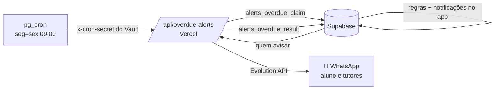

# ⏰ Alertas de atraso da entrega semanal

Quando o **prazo de uma entrega semanal** vence e o aluno ainda não enviou, ele é lembrado por **WhatsApp** e por **notificação no app**, e os **tutores** recebem um resumo (também por WhatsApp e no app). O tutor pode **pausar os alertas de um aluno**.

## O que é "atraso"

A entrega semanal fecha na sessão indicada em `weekly_deliverables.session_day` (dias 5, 10, 15, 20, 25 e 30). O aluno está **em atraso** quando:

- o prazo (`due_date`) já passou, **e**
- falta enviar **alguma tentativa** (de qualquer status) de pelo menos um exercício dessa sessão.

Quem **já enviou** (aguardando correção) ou precisa **refazer** não é considerado atrasado. A sessão em si ficar pendente de aprovação não gera alerta.

## Regras de envio

| Regra | Valor |
|---|---|
| Quando roda | dias úteis (seg–sex), **09:00 de Brasília** — nunca em fim de semana |
| Intervalo | no máximo **1 aviso a cada 3 dias** por aluno |
| Teto | no máximo **8 avisos** por aluno |
| Quem recebe | alunos com WhatsApp verificado e alertas **ativos**, cujo prazo é **posterior ao cadastro** (quem entra no meio do programa não recebe aviso de semanas antigas) |
| Várias semanas atrasadas | **uma** mensagem lista as semanas (as 3 mais antigas + "e mais N") |
| Tutores | recebem **notificação no app** e **WhatsApp** (se tiverem número) com os alunos avisados na rodada; sem avisos novos, não há mensagem |
| Pausa | tutor pausa/retoma **por aluno**: sem avisos, e fora do resumo dos tutores (o resumo informa quantos estão pausados) |

Feriados não são considerados: se o job cair num feriado em dia útil, ele roda normalmente (pause os alertas dos alunos que combinaram outro prazo).

## Onde o tutor controla

- **Alunos →** coluna **Atraso** (⏰ nº de semanas vencidas, 🔕 se pausado).
- **Alunos → (um aluno) → ⏰ Alertas de atraso:** mostra as semanas em atraso e o botão **Pausar / Retomar alertas deste aluno**.

## Como funciona (arquitetura)



O **banco** decide quem é avisado e já cria as notificações no app; a função do Vercel só envia o WhatsApp e registra o resultado (`overdue_alerts.whatsapp_status`: `sent`, `failed` ou `skipped` quando o aluno não tem número). Falha no WhatsApp não impede a notificação no app.

## Configuração

1. **Migration** `20261106000022_overdue_alerts.sql`.
2. **Variáveis no Vercel** (já usadas pelo WhatsApp): `EVOLUTION_API_URL`, `EVOLUTION_API_KEY`, `EVOLUTION_INSTANCE`, `SUPABASE_SERVICE_ROLE_KEY`. Opcional: `APP_URL` (padrão `https://dafa-rho.vercel.app`) — endereço usado nos links das mensagens.
3. **Segredo do agendador** no Vault do Supabase, `dafa_cron_secret` (o mesmo do job de correção por IA). A rota não precisa de variável nova: ela valida o segredo chamando o banco (`cron_secret_ok`).
4. **Agendar** (SQL Editor):

```sql
select cron.schedule(
  'dafa-alertas-atraso',
  '0 12 * * 1-5',            -- 12:00 UTC = 09:00 de Brasília, seg–sex
  $job$
  select net.http_post(
    url     := 'https://dafa-rho.vercel.app/api/overdue-alerts',
    headers := jsonb_build_object('Content-Type', 'application/json',
                 'x-cron-secret', (select decrypted_secret from vault.decrypted_secrets where name = 'dafa_cron_secret')),
    body    := '{}'::jsonb,
    timeout_milliseconds := 60000);
  $job$);
```

Teste manual (ignora a regra de fim de semana): chame o mesmo `net.http_post` com corpo `{"force": true}`. Resposta: `students_alerted`, `whatsapp_sent`, `whatsapp_failed`, `whatsapp_skipped`, `tutors_notified`, `paused_count`.

Pausar o job: `select cron.unschedule('dafa-alertas-atraso');`

## Limites

- O WhatsApp é enviado em sequência com pausa de ~0,8 s entre mensagens (e a rota tem limite de 60 s): até **40 alunos por rodada**; se houver mais, o restante é avisado na rodada seguinte.
- Se a Evolution API falhar para um aluno, **não há nova tentativa no mesmo dia**; o aviso será repetido na rodada de 3 dias depois, e o app já mostra a notificação.
- "Entregou" é verificado só pela existência de uma tentativa; a qualidade e a aprovação são tratadas no fluxo de correção.
