# 🏆 Toolkit Avançado

> **Objetivo do nível:** Gerar decisões: segmentação, previsão, testes A/B, análise financeira, IA aplicada, dashboards executivos e projeto final.
>
> Semanas 5–6 · Dias 21–30 · RFM, forecast, A/B, automação, storytelling e capstone.

```mermaid
flowchart LR
  D21["D21<br/>KPIs por área e árvore de mé"]
  D22["D22<br/>Segmentação de clientes: RFM"]
  D21 --> D22
  D23["D23<br/>Previsão de séries temporais"]
  D22 --> D23
  D24["D24<br/>Testes A/B e inferência para"]
  D23 --> D24
  D25["D25<br/>Análise financeira e entrega"]
  D24 --> D25
  D26["D26<br/>IA aplicada à análise: promp"]
  D25 --> D26
  D27["D27<br/>Automação de relatórios com "]
  D26 --> D27
  D28["D28<br/>Dashboard executivo avançado"]
  D27 --> D28
  D29["D29<br/>Data storytelling e apresent"]
  D28 --> D29
  D30["D30<br/>Projeto final (capstone) e d"]
  D29 --> D30
```

---

## Dia 21 · seg 07/12 — KPIs por área e árvore de métricas

⏱️ 120 min · Depende de: Dia 16, Dia 20

### 1) Conceitual
**Por quê?** Métricas soltas confundem; árvores de métricas mostram o que move o resultado e onde agir.

**O que você vai aprender**
- Árvore de métricas (North Star → drivers)
- KPIs de Comercial, Financeiro, Logística, E-commerce, Marketing e Esporte
- Leading vs. lagging indicators
- Metas, limites e alertas

**Cenários de uso**
- **E-commerce:** Receita = visitantes × conversão × ticket médio; qual driver caiu?
- **Esporte:** Receita de bilheteria = público × preço médio; o que muda com a posição na tabela?

### 2) Conexão com as ferramentas
Conecta tudo: cada folha da árvore vira uma consulta SQL ou medida DAX.

Ferramentas: Excel x-kpis · Power BI · SQL

### 3) Exercícios
1. **Árvore de métricas** — Desenhe a árvore da receita de e-commerce com 3 níveis.  
   _Entrega:_ Diagrama
2. **Implementar 5 KPIs** — Calcule 5 KPIs da árvore em SQL ou DAX.  
   _Entrega:_ Queries/medidas

### 4) Templates
- 📗 [Planilha: catálogo de KPIs por área](../web/public/templates/kpis-areas.xlsx) — KPI, fórmula, fonte, frequência e dono para Comercial, Financeiro, Logística, E-commerce, Esporte e Marketing.
- 🗄️ [Agregações (GROUP BY / HAVING)](../toolkit/templates/sql/t-sql-agregacao.sql) — Totais, médias e rankings por dimensão.

### 5) Recursos
- [Microsoft Learn – Power BI](https://learn.microsoft.com/power-bi/) — Trilhas gratuitas e documentação completa do Power BI.

---

## Dia 22 · ter 08/12 — Segmentação de clientes: RFM e coortes

⏱️ 150 min · Depende de: Dia 21

### 1) Conceitual
**Por quê?** Nem todo cliente vale o mesmo. Segmentar permite campanhas, atendimento e preços diferentes, aumentando retenção e ROI.

**O que você vai aprender**
- Recência, Frequência e Valor (RFM)
- NTILE e regras de segmento
- Análise de coortes e retenção
- Ações por segmento

**Cenários de uso**
- **Marketing:** Reativar "Em risco" com cupom e proteger "Campeões" com benefícios.
- **E-commerce:** Retenção por canal de aquisição.

### 2) Conexão com as ferramentas
Query RFM em SQL → visual no Power BI → interpretação com Python/IA.

Ferramentas: SQL · Python · Power BI

### 3) Exercícios
1. **RFM em SQL** — Rode o RFM, valide a distribuição dos segmentos e explique as regras.  
   _Entrega:_ Query + tabela de segmentos
2. **Ação por segmento** — Proponha 1 ação por segmento com meta e custo estimado.  
   _Entrega:_ Plano de ação

### 4) Templates
- 🗄️ [RFM e coortes de clientes](../toolkit/templates/sql/t-sql-rfm.sql) — Recência, Frequência, Valor e retenção por coorte.

### 5) Recursos
- [Supabase – SQL Editor](https://supabase.com/dashboard) — Painel do Supabase. Peça acesso ao tutor para usar o SQL Editor, ou conecte-se por qualquer cliente SQL com o usuário aluno_leitura.

---

## Dia 23 · qua 09/12 — Previsão de séries temporais (forecast)

⏱️ 150 min · Depende de: Dia 19, Dia 21

### 1) Conceitual
**Por quê?** Planejar estoque, caixa e metas exige olhar para frente. O essencial é saber comparar modelos simples e comunicar a incerteza.

**O que você vai aprender**
- Tendência e sazonalidade
- Baselines: média móvel e sazonal ingênuo
- Holt-Winters
- Erro (MAE/MAPE) e quando não confiar

**Cenários de uso**
- **Financeiro:** Projeção de receita e caixa para os próximos 6 meses.
- **Logística:** Previsão de volume de pedidos para dimensionar equipe na alta temporada.

### 2) Conexão com as ferramentas
A série vem do SQL do dia 12; o Python faz o modelo; o Power BI mostra o resultado.

Ferramentas: Python (statsmodels) · Prompt p-forecast · Power BI (forecast visual)

### 3) Exercícios
1. **Comparar 3 modelos** — Compare MA3, sazonal ingênuo e Holt-Winters com MAPE.  
   _Entrega:_ Notebook + tabela de erros
2. **Previsão de 6 meses** — Projete 6 meses com faixa de incerteza e comente premissas.  
   _Entrega:_ Gráfico + 5 linhas de leitura

### 4) Templates
- 🤖 [Prompt: previsão simples de série temporal](../toolkit/templates/prompt/p-forecast.md) — Baseline (média móvel / sazonal ingênuo) e Holt-Winters.
- 🗄️ [CTEs, subqueries e window functions](../toolkit/templates/sql/t-sql-cte-window.sql) — Ranking, acumulado e variação mês a mês.

### 5) Recursos
- [Download do Python](https://www.python.org/downloads/) — Instale Python 3.12+ e marque "Add python.exe to PATH". Depois: pip install pandas matplotlib seaborn psycopg[binary] sqlalchemy statsmodels.

---

## Dia 24 · qui 10/12 — Testes A/B e inferência para decisão

⏱️ 120 min · Depende de: Dia 23

### 1) Conceitual
**Por quê?** Testar antes de escalar evita decisões caras baseadas em sorte. Você aprende a ler p-valor e intervalo de confiança como gestor.

**O que você vai aprender**
- Hipótese nula e alternativa
- Teste de duas proporções
- p-valor, intervalo de confiança e poder
- Armadilhas: parar cedo, múltiplos testes, sazonalidade

**Cenários de uso**
- **Marketing:** Assunto de e-mail A vs. B: qual converte mais?
- **E-commerce:** Frete grátis acima de R$ X aumenta o ticket médio?

### 2) Conexão com as ferramentas
Usa taxas calculadas em SQL (dia 8) e a revisão crítica de código (dia 18).

Ferramentas: Python (statsmodels) · Prompt p-abtest

### 3) Exercícios
1. **Rodar um teste A/B** — Analise o cenário fornecido pelo tutor ou use dados de fato_campanhas.  
   _Entrega:_ Notebook + decisão
2. **Recomendação executiva** — Escreva a recomendação em 3 linhas para o diretor.  
   _Entrega:_ Texto

### 4) Templates
- 🤖 [Prompt: teste A/B](../toolkit/templates/prompt/p-abtest.md) — Teste de proporções, intervalo de confiança e decisão.
- 🤖 [Prompt: revisar código gerado por IA](../toolkit/templates/prompt/p-revisao-codigo.md) — Checklist de revisão antes de confiar no resultado.

### 5) Recursos
- [Download do Python](https://www.python.org/downloads/) — Instale Python 3.12+ e marque "Add python.exe to PATH". Depois: pip install pandas matplotlib seaborn psycopg[binary] sqlalchemy statsmodels.

---

## Dia 25 · sex 11/12 — Análise financeira e entrega da Semana 5 📦

⏱️ 150 min · Depende de: Dia 16, Dia 22

### 1) Conceitual
**Por quê?** Toda análise administrativa termina em impacto financeiro. DRE, fluxo de caixa e orçado x realizado traduzem dados em decisão de investimento.

**O que você vai aprender**
- DRE simplificada e margem
- Fluxo de caixa acumulado
- Orçado x realizado e variações
- Sensibilidade simples (e se o custo subir 5%?)

**Cenários de uso**
- **Financeiro:** Variação de despesas por centro de custo vs. orçamento.
- **Comercial:** Impacto no resultado de reduzir desconto em 2 p.p.
- **Esporte:** Resultado da temporada: bilheteria vs. custos operacionais.

### 2) Conexão com as ferramentas
Reúne SQL (agregação), Excel (modelo) e Power BI (visual) numa análise completa com recomendação.

Ferramentas: SQL · Excel DRE · Power BI

### 3) Exercícios
1. **DRE e caixa** — Monte DRE mensal e caixa acumulado em SQL e Excel.  
   _Entrega:_ Query + planilha
2. **Relatório da semana** — Segmentação (RFM) + previsão + financeiro com recomendação por área.  
   _Entrega:_ Documento de entrega

### 4) Templates
- 🗄️ [DRE simplificada e orçamento x realizado](../toolkit/templates/sql/t-sql-financeiro.sql) — Resultado mensal e fluxo de caixa acumulado.
- 📗 [Planilha: DRE e fluxo de caixa](../web/public/templates/dre-fluxo-caixa.xlsx) — Modelo com receitas, despesas, resultado e caixa acumulado com fórmulas.
- 📦 [Modelo de relatório de entrega semanal](../toolkit/templates/entrega/c-entrega-semanal.md) — Estrutura para o documento que acompanha cada entrega semanal.

### 5) Recursos
- [Supabase – SQL Editor](https://supabase.com/dashboard) — Painel do Supabase. Peça acesso ao tutor para usar o SQL Editor, ou conecte-se por qualquer cliente SQL com o usuário aluno_leitura.
- [Microsoft Learn – Power BI](https://learn.microsoft.com/power-bi/) — Trilhas gratuitas e documentação completa do Power BI.

> 📦 **Entregável semanal 5:** Segmentação e previsão — Relatório com RFM de clientes, previsão de receita de 6 meses e análise financeira (DRE + caixa), com recomendação por área.

---

## Dia 26 · seg 14/12 — IA aplicada à análise: prompts, validação e ética

⏱️ 120 min · Depende de: Dia 20

### 1) Conceitual
**Por quê?** A IA multiplica a produtividade, mas também erra com confiança. Você precisa de processo para verificar resultados e proteger dados sensíveis.

**O que você vai aprender**
- Padrão de prompt: papel, contexto, tarefa, restrições, formato
- Few-shot e iteração
- Alucinação e checagem por testes
- LGPD: nunca enviar dados pessoais reais a ferramentas não aprovadas

**Cenários de uso**
- **Marketing:** Resumir comentários de clientes sem expor dados pessoais.
- **Financeiro:** Gerar código de conciliação e validar com totais de controle.

### 2) Conexão com as ferramentas
Todos os prompts da biblioteca seguem este padrão; hoje você cria os seus.

Ferramentas: Assistente de IA · Prompts p-* · Checklist de revisão

### 3) Exercícios
1. **Criar 2 prompts próprios** — Crie prompts para tarefas da sua rotina e registre versões v1→v2.  
   _Entrega:_ Biblioteca de prompts
2. **Caça aos erros** — Revise um código com 3 erros plantados pelo tutor.  
   _Entrega:_ Tabela Problema|Correção

### 4) Templates
- 🤖 [Prompt: revisar código gerado por IA](../toolkit/templates/prompt/p-revisao-codigo.md) — Checklist de revisão antes de confiar no resultado.
- 🤖 [Prompt: análise exploratória com pandas](../toolkit/templates/prompt/p-pandas-analise.md) — Gera EDA guiada por perguntas de negócio.

### 5) Recursos
- [Download do Python](https://www.python.org/downloads/) — Instale Python 3.12+ e marque "Add python.exe to PATH". Depois: pip install pandas matplotlib seaborn psycopg[binary] sqlalchemy statsmodels.

---

## Dia 27 · ter 15/12 — Automação de relatórios com Python

⏱️ 150 min · Depende de: Dia 26

### 1) Conceitual
**Por quê?** Se você repete uma análise toda semana, ela deve rodar sozinha: menos esforço, menos erros e mais tempo para interpretar.

**O que você vai aprender**
- Estrutura de script (funções, main, argparse)
- Gerar Excel formatado e imagens
- Logs e tratamento de erros
- Agendamento (Windows Task Scheduler / cron)

**Cenários de uso**
- **Comercial:** Relatório semanal de vendas por e-mail às segundas.
- **Logística:** Alerta diário de pedidos atrasados.

### 2) Conexão com as ferramentas
Une consultas SQL, tratamento pandas e gráficos numa rotina completa.

Ferramentas: Python (openpyxl, pandas) · Prompt p-automacao

### 3) Exercícios
1. **Script de relatório** — Gere relatorio_semanal.py com a IA, revise e rode.  
   _Entrega:_ Script + Excel gerado
2. **Plano de agendamento** — Escreva os passos para agendar e monitorar.  
   _Entrega:_ Passo a passo

### 4) Templates
- 🤖 [Prompt: automação de relatório semanal](../toolkit/templates/prompt/p-automacao.md) — Script que consulta o banco, gera Excel/PNG e pode ser agendado.
- 🤖 [Prompt: revisar código gerado por IA](../toolkit/templates/prompt/p-revisao-codigo.md) — Checklist de revisão antes de confiar no resultado.

### 5) Recursos
- [Download do Python](https://www.python.org/downloads/) — Instale Python 3.12+ e marque "Add python.exe to PATH". Depois: pip install pandas matplotlib seaborn psycopg[binary] sqlalchemy statsmodels.
- [Visual Studio Code + extensão Python/Jupyter](https://code.visualstudio.com/download) — Editor para rodar scripts e notebooks (.ipynb) das sessões de Python.

---

## Dia 28 · qua 16/12 — Dashboard executivo avançado no Power BI

⏱️ 150 min · Depende de: Dia 16, Dia 25

### 1) Conceitual
**Por quê?** Executivos têm 2 minutos. Navegação clara, drill-through e segurança por perfil entregam a resposta certa para a pessoa certa.

**O que você vai aprender**
- Drill-through e tooltips de página
- Bookmarks e botões
- Segurança em nível de linha (RLS)
- Desempenho e publicação

**Cenários de uso**
- **Comercial:** Gerente regional vê só sua região (RLS).
- **Financeiro:** Do resultado consolidado ao detalhe por centro de custo com drill-through.

### 2) Conexão com as ferramentas
Usa o modelo (dia 13), as medidas (15–16) e os KPIs (21).

Ferramentas: Power BI Desktop · Checklist de qualidade

### 3) Exercícios
1. **Dashboard v2** — Adicione drill-through, bookmark e tooltip.  
   _Entrega:_ .pbix v2
2. **RLS de demonstração** — Crie 2 funções e teste com Exibir como.  
   _Entrega:_ Prints dos testes

### 4) Templates
- 📊 [Roteiro .pbix: relatório de vendas (3 páginas)](../toolkit/templates/pbix/b-pbix-guia.md) — Especificação para construir seu arquivo .pbix no Power BI Desktop (e modelo de correção do tutor).
- 📊 [Pacote de medidas DAX](../toolkit/templates/pbix/b-dax-pack.dax) — Medidas básicas, de campanhas (CPA e CTR) e de inteligência de tempo.
- ✅ [Checklist de qualidade de relatório/dashboard](../toolkit/templates/checklist/c-relatorio.md) — Use antes de enviar qualquer entrega visual.

### 5) Recursos
- [Download do Power BI Desktop](https://www.microsoft.com/en-us/download/details.aspx?id=58494) — Instalador oficial da Microsoft (ou instale pela Microsoft Store: aka.ms/pbidesktopstore, que atualiza sozinho). Somente Windows.
- [Microsoft Learn – Power BI](https://learn.microsoft.com/power-bi/) — Trilhas gratuitas e documentação completa do Power BI.
- [DAX Guide](https://dax.guide/) — Referência de todas as funções DAX com exemplos.

---

## Dia 29 · qui 17/12 — Data storytelling e apresentação executiva

⏱️ 120 min · Depende de: Dia 28

### 1) Conceitual
**Por quê?** Uma análise só gera valor se for compreendida e levar à ação. Storytelling transforma números em decisão.

**O que você vai aprender**
- Estrutura Contexto → Problema → Evidência → Recomendação
- Títulos como conclusões
- Reduzir carga cognitiva
- Responder objeções

**Cenários de uso**
- **Marketing:** Convencer o diretor a realocar 20% do orçamento.
- **Esporte:** Apresentar à diretoria o impacto de preços de ingresso no público.

### 2) Conexão com as ferramentas
Seleciona os melhores resultados de SQL, Power BI e Python para a narrativa.

Ferramentas: PowerPoint/Google Slides · Roteiro de 5 slides

### 3) Exercícios
1. **Apresentação de 5 slides** — Monte a história do seu projeto final.  
   _Entrega:_ Deck
2. **Ensaio de 5 minutos** — Grave ou ensaie e liste as 3 perguntas difíceis que esperam de você.  
   _Entrega:_ Lista de perguntas e respostas

### 4) Templates
- ✅ [Roteiro de storytelling (5 slides)](../toolkit/templates/checklist/c-storytelling.md) — Contexto → Problema → Evidência → Recomendação → Próximos passos.
- ✅ [Checklist de qualidade de relatório/dashboard](../toolkit/templates/checklist/c-relatorio.md) — Use antes de enviar qualquer entrega visual.

### 5) Recursos
- [Microsoft Learn – Power BI](https://learn.microsoft.com/power-bi/) — Trilhas gratuitas e documentação completa do Power BI.

---

## Dia 30 · sex 18/12 — Projeto final (capstone) e defesa 📦

⏱️ 180 min · Depende de: Dia 24, Dia 27, Dia 29

### 1) Conceitual
**Por quê?** Fecha o ciclo: você escolhe uma área e entrega uma solução completa, do dado à decisão, defendida ao tutor.

**O que você vai aprender**
- Integrar SQL + Power BI + Python
- Documentação e reprodutibilidade
- Defesa técnica e de negócio
- Plano de continuidade de estudos

**Cenários de uso**
- **Comercial:** Plano para elevar a margem em 2 p.p.
- **Logística:** Reduzir o atraso em 30% em 2 trimestres.
- **Esporte:** Estratégia de ocupação do estádio.

### 2) Conexão com as ferramentas
Use o diagrama de fluxo ETL para mostrar a arquitetura da sua solução.

Ferramentas: Todas as ferramentas do programa

### 3) Exercícios
1. **Dashboard + notebook + SQL** — Entregue os artefatos organizados em pasta/repositório com README.  
   _Entrega:_ Link da pasta
2. **Apresentação ao tutor** — Apresente em 10 minutos e responda perguntas.  
   _Entrega:_ Slides + gravação/ata

### 4) Templates
- 🧩 [Fluxo ETL: fonte → modelo → relatório](../toolkit/templates/diagram/d-fluxo-etl.md) — Desenho do fluxo de dados para sua entrega.
- ✅ [Roteiro de storytelling (5 slides)](../toolkit/templates/checklist/c-storytelling.md) — Contexto → Problema → Evidência → Recomendação → Próximos passos.
- 📦 [Modelo de relatório de entrega semanal](../toolkit/templates/entrega/c-entrega-semanal.md) — Estrutura para o documento que acompanha cada entrega semanal.
- ✅ [Checklist de qualidade de relatório/dashboard](../toolkit/templates/checklist/c-relatorio.md) — Use antes de enviar qualquer entrega visual.

### 5) Recursos
- [Supabase do programa (banco de análise)]((URL do Supabase informada pelo tutor)) — Projeto Supabase usado como banco de análise (schema "treinamento"). Host de conexão e usuário somente-leitura são informados pelo tutor.
- [Download do Power BI Desktop](https://www.microsoft.com/en-us/download/details.aspx?id=58494) — Instalador oficial da Microsoft (ou instale pela Microsoft Store: aka.ms/pbidesktopstore, que atualiza sozinho). Somente Windows.
- [Download do Python](https://www.python.org/downloads/) — Instale Python 3.12+ e marque "Add python.exe to PATH". Depois: pip install pandas matplotlib seaborn psycopg[binary] sqlalchemy statsmodels.

> 📦 **Entregável semanal 6:** Projeto final (capstone) — Dashboard executivo + apresentação de 5 slides + repositório/pasta com SQL, Python e documentação, apresentado ao tutor.
