# 🚀 Toolkit Intermediário

> **Objetivo do nível:** Modelar dados, combinar tabelas, transformar com Power Query, calcular com DAX e automatizar análises com Python e IA.
>
> Semanas 3–4 · Dias 11–20 · SQL III–IV, modelo estrela, DAX, Python/pandas.

```mermaid
flowchart LR
  D11["D11<br/>SQL III: JOINs e combinação "]
  D12["D12<br/>SQL IV: CTEs, subqueries e w"]
  D11 --> D12
  D13["D13<br/>Modelagem dimensional: model"]
  D12 --> D13
  D14["D14<br/>Power Query: ETL sem código"]
  D13 --> D14
  D15["D15<br/>DAX I: medidas e contexto – "]
  D14 --> D15
  D16["D16<br/>DAX II: inteligência de temp"]
  D15 --> D16
  D17["D17<br/>Python: instalação, VS Code "]
  D16 --> D17
  D18["D18<br/>Python com IA: limpeza e aná"]
  D17 --> D18
  D19["D19<br/>Visualização em Python e est"]
  D18 --> D19
  D20["D20<br/>Python + Supabase e entrega "]
  D19 --> D20
```

---

## Dia 11 · seg 23/11 — SQL III: JOINs e combinação de tabelas

⏱️ 120 min · Depende de: Dia 8

### 1) Conceitual
**Por quê?** Quase toda pergunta relevante cruza tabelas (quem comprou o quê, quando, entregue por quem). JOINs corretos evitam o erro mais comum: duplicar linhas e inflar números.

**O que você vai aprender**
- INNER, LEFT, RIGHT, FULL JOIN
- Cardinalidade e o risco de duplicação
- Anti-join (LEFT + IS NULL)
- Conferência de totais antes e depois do JOIN

**Cenários de uso**
- **E-commerce:** Clientes cadastrados que nunca compraram (campanha de ativação).
- **Logística:** Atraso por transportadora cruzando pedidos e entregas.
- **Comercial:** Margem por categoria cruzando itens e produtos.

### 2) Conexão com as ferramentas
Os relacionamentos que você desenhará no Power BI (dia 13) são JOINs permanentes; entender o SQL evita erros de modelo.

Ferramentas: Supabase SQL Editor · Template t-sql-joins

### 3) Exercícios
1. **Margem por categoria** — Calcule receita, custo e margem % por categoria.  
   _Entrega:_ Query validada
2. **Anti-join** — Liste clientes sem compras por canal de aquisição.  
   _Entrega:_ Query + contagem
3. **Teste de duplicação** — Demonstre com contagens que o JOIN não duplicou linhas.  
   _Entrega:_ Nota com conferência

### 4) Templates
- 📗 [Dicionário de dados (Excel)](../web/public/templates/dicionario-dados.xlsx) — Guia das 8 tabelas: o que cada coluna significa, valores possíveis, como as tabelas se ligam e os cuidados de cálculo.
- 🗄️ [JOINs entre fatos e dimensões](../toolkit/templates/sql/t-sql-joins.sql) — INNER/LEFT JOIN para responder perguntas de negócio.

### 5) Recursos
- [Supabase – SQL Editor](https://supabase.com/dashboard) — Painel do Supabase. Peça acesso ao tutor para usar o SQL Editor, ou conecte-se por qualquer cliente SQL com o usuário aluno_leitura.
- [Tutorial SQL do PostgreSQL](https://www.postgresql.org/docs/current/tutorial.html) — Documentação oficial do Postgres (mesmo motor do Supabase).

---

## Dia 12 · ter 24/11 — SQL IV: CTEs, subqueries e window functions

⏱️ 150 min · Depende de: Dia 11

### 1) Conceitual
**Por quê?** Rankings, acumulados e variações período a período são perguntas diárias de gestão. Window functions resolvem sem planilhas auxiliares.

**O que você vai aprender**
- WITH (CTE) para organizar consultas
- ROW_NUMBER, RANK, NTILE
- LAG/LEAD e acumulados (SUM OVER)
- FILTER e CASE em agregações

**Cenários de uso**
- **Financeiro:** Caixa acumulado e variação mês a mês.
- **Comercial:** Top 3 produtos por categoria.
- **Esporte:** Classificação da temporada com pontos acumulados por rodada.

### 2) Conexão com as ferramentas
As mesmas ideias aparecem como medidas DAX (YTD, mês anterior) nos dias 15–16.

Ferramentas: Supabase SQL Editor · Template t-sql-cte-window

### 3) Exercícios
1. **Variação mês a mês** — Calcule receita, mês anterior, var % e acumulado.  
   _Entrega:_ Query
2. **Top N por grupo** — Top 3 produtos por categoria com RANK.  
   _Entrega:_ Query
3. **Tabela de classificação** — Monte a classificação de uma temporada de esporte_partidas.  
   _Entrega:_ Query + prints

### 4) Templates
- 🗄️ [CTEs, subqueries e window functions](../toolkit/templates/sql/t-sql-cte-window.sql) — Ranking, acumulado e variação mês a mês.

### 5) Recursos
- [Supabase – SQL Editor](https://supabase.com/dashboard) — Painel do Supabase. Peça acesso ao tutor para usar o SQL Editor, ou conecte-se por qualquer cliente SQL com o usuário aluno_leitura.
- [Tutorial SQL do PostgreSQL](https://www.postgresql.org/docs/current/tutorial.html) — Documentação oficial do Postgres (mesmo motor do Supabase).

---

## Dia 13 · qua 25/11 — Modelagem dimensional: modelo estrela

⏱️ 120 min · Depende de: Dia 10, Dia 11

### 1) Conceitual
**Por quê?** Um bom modelo torna as medidas simples, rápidas e corretas. Um modelo ruim gera números diferentes em cada tela.

**O que você vai aprender**
- Fato vs. dimensão e granularidade
- Esquema estrela vs. flocos de neve
- Tabela de datas (calendário) obrigatória
- Direção de filtro e relacionamentos 1:N

**Cenários de uso**
- **E-commerce:** Fato vendas com dimensões Data, Cliente, Produto e Canal.
- **Marketing:** Fato campanhas com dimensão Canal compartilhada com vendas (dimensão conforme).

### 2) Conexão com as ferramentas
Você aplica o que viu em JOINs: cada relacionamento do modelo é um JOIN que o Power BI executa para você.

Ferramentas: Power BI – Modo Modelo · Mermaid (desenho do modelo)

### 3) Exercícios
1. **Desenhar o modelo estrela** — Desenhe o modelo com granularidade declarada.  
   _Entrega:_ Diagrama Mermaid/imagem
2. **Montar no Power BI** — Importe as tabelas, crie dim_data e os relacionamentos corretos.  
   _Entrega:_ Print do modelo

### 4) Templates
- 🧩 [Modelo estrela para Power BI](../toolkit/templates/diagram/d-star-schema.md) — Fato Vendas no centro, dimensões Data, Cliente, Produto, Canal.
- 🧩 [Diagrama ER do banco de análise](../toolkit/templates/diagram/d-er-modelo.md) — Estrutura de dados do schema treinamento (renderiza no GitHub/Mermaid Live).

### 5) Recursos
- [Microsoft Learn – Power BI](https://learn.microsoft.com/power-bi/) — Trilhas gratuitas e documentação completa do Power BI.
- [DAX Guide](https://dax.guide/) — Referência de todas as funções DAX com exemplos.

---

## Dia 14 · qui 26/11 — Power Query: ETL sem código

⏱️ 120 min · Depende de: Dia 13

### 1) Conceitual
**Por quê?** Transformações feitas no Power Query ficam registradas e se repetem a cada atualização, eliminando a "limpeza manual" mensal.

**O que você vai aprender**
- Etapas aplicadas e linguagem M (visão geral)
- Tipagem, divisão, mesclagem e acréscimo de consultas
- Colunas personalizadas e condicionais
- Parâmetros e boas práticas de desempenho

**Cenários de uso**
- **Financeiro:** Consolidar 12 arquivos mensais de lançamentos numa só tabela.
- **Logística:** Criar a coluna no_prazo e dias_atraso na tabela de entregas.

### 2) Conexão com as ferramentas
Power Query faz o papel do SQL de preparação e do pandas de limpeza. Decidir onde transformar (banco, Power Query ou Python) é uma habilidade-chave.

Ferramentas: Power Query (Power BI/Excel) · Fluxo ETL (diagrama)

### 3) Exercícios
1. **Colunas de logística** — Crie no_prazo (booleano) e dias_atraso em fato_entregas.  
   _Entrega:_ Etapas aplicadas documentadas
2. **Mapa do fluxo ETL** — Desenhe o fluxo fonte → transformação → modelo → relatório.  
   _Entrega:_ Diagrama

### 4) Templates
- 🧩 [Fluxo ETL: fonte → modelo → relatório](../toolkit/templates/diagram/d-fluxo-etl.md) — Desenho do fluxo de dados para sua entrega.

### 5) Recursos
- [Microsoft Learn – Power BI](https://learn.microsoft.com/power-bi/) — Trilhas gratuitas e documentação completa do Power BI.

---

## Dia 15 · sex 27/11 — DAX I: medidas e contexto – entrega da Semana 3 📦

⏱️ 150 min · Depende de: Dia 14

### 1) Conceitual
**Por quê?** Medidas DAX calculam números corretos em qualquer filtro. Entender contexto de filtro é o que separa quem "arrasta campos" de quem constrói análises confiáveis.

**O que você vai aprender**
- Coluna calculada vs. medida
- Contexto de linha e de filtro
- CALCULATE, SUMX, DIVIDE, DISTINCTCOUNT
- ALL / REMOVEFILTERS para % do total
- Medidas sobre uma tabela sem relacionamento (fato_campanhas): CPA e CTR

**Cenários de uso**
- **Comercial:** Ticket médio e % da receita por canal.
- **Marketing:** CTR e CPA por campanha.

### 2) Conexão com as ferramentas
Compare o resultado de cada medida com a query SQL equivalente (dias 8 e 11). Divergências revelam erros de modelo. CPA e CTR vêm de fato_campanhas, que não tem chave em comum com as tabelas de vendas: ela entra no modelo sozinha, sem relacionamento, e suas medidas somam as próprias colunas.

Ferramentas: Power BI Desktop · DAX Guide · Pacote de medidas DAX

### 3) Exercícios
1. **8 medidas base** — Importe também a tabela fato_campanhas (ela fica sem relacionamento com as demais). Crie Receita, Custo, Margem %, Pedidos, Ticket Médio e % do Total e, a partir de fato_campanhas, CPA (investimento ÷ conversões) e CTR (cliques ÷ impressões).  
   _Entrega:_ Lista de medidas + prints
2. **Validação cruzada** — Prove que 3 medidas batem com SQL.  
   _Entrega:_ Tabela de conferência

### 4) Templates
- 📊 [Pacote de medidas DAX](../toolkit/templates/pbix/b-dax-pack.dax) — Medidas básicas, de campanhas (CPA e CTR) e de inteligência de tempo.
- 🧩 [Modelo estrela para Power BI](../toolkit/templates/diagram/d-star-schema.md) — Fato Vendas no centro, dimensões Data, Cliente, Produto, Canal.
- 📦 [Modelo de relatório de entrega semanal](../toolkit/templates/entrega/c-entrega-semanal.md) — Estrutura para o documento que acompanha cada entrega semanal.

### 5) Recursos
- [DAX Guide](https://dax.guide/) — Referência de todas as funções DAX com exemplos.
- [Microsoft Learn – Power BI](https://learn.microsoft.com/power-bi/) — Trilhas gratuitas e documentação completa do Power BI.

> 📦 **Entregável semanal 3:** Modelo estrela com medidas DAX — Arquivo .pbix com modelo estrela (dim_data, dim_clientes, dim_produtos), Power Query documentado e 8 medidas DAX.

---

## Dia 16 · seg 30/11 — DAX II: inteligência de tempo

⏱️ 120 min · Depende de: Dia 15

### 1) Conceitual
**Por quê?** Gestores comparam sempre com o período anterior. Inteligência de tempo entrega YTD, mês anterior e 12 meses móveis sem refazer cálculos.

**O que você vai aprender**
- Tabela de datas marcada como tal
- TOTALYTD, DATEADD, SAMEPERIODLASTYEAR
- Médias móveis (DATESINPERIOD)
- Variações absolutas e percentuais

**Cenários de uso**
- **Financeiro:** Resultado acumulado no ano vs. ano anterior.
- **E-commerce:** Receita dos últimos 12 meses e crescimento mensal.

### 2) Conexão com as ferramentas
Equivale às window functions LAG/SUM OVER do dia 12; use a SQL como gabarito.

Ferramentas: Power BI Desktop · Pacote DAX

### 3) Exercícios
1. **Painel de variação** — Crie YTD, Mês Ant., Var % e 12M e exiba em linha + cartões.  
   _Entrega:_ Página .pbix
2. **Caso de teste** — Escolha um mês e confirme os valores com SQL.  
   _Entrega:_ Nota de validação

### 4) Templates
- 📊 [Pacote de medidas DAX](../toolkit/templates/pbix/b-dax-pack.dax) — Medidas básicas, de campanhas (CPA e CTR) e de inteligência de tempo.
- 🗄️ [CTEs, subqueries e window functions](../toolkit/templates/sql/t-sql-cte-window.sql) — Ranking, acumulado e variação mês a mês.

### 5) Recursos
- [DAX Guide](https://dax.guide/) — Referência de todas as funções DAX com exemplos.

---

## Dia 17 · ter 01/12 — Python: instalação, VS Code e pandas básico

⏱️ 150 min · Depende de: Dia 10

### 1) Conceitual
**Por quê?** Python automatiza análises repetidas e abre portas para estatística, previsão e IA. Para o administrativo, o objetivo não é programar tudo, e sim saber pedir, ler e validar código.

**O que você vai aprender**
- Instalar Python e VS Code
- Ambiente virtual e pip
- DataFrame: ler CSV/Excel, head, info, describe
- Selecionar, filtrar e ordenar com pandas

**Cenários de uso**
- **Comercial:** Ler a planilha de pedidos e filtrar o canal app em segundos.
- **Logística:** Calcular dias de atraso e listar os piores casos.

### 2) Conexão com as ferramentas
Cada operação pandas tem equivalente em SQL (query, groupby) e Excel (filtro, dinâmica). Veja a tabela de tradução no template de prompt.

Ferramentas: Python 3.12+ · VS Code · pandas

### 3) Exercícios
1. **Ambiente funcionando** — Instale Python, crie venv e rode um script que imprime a versão e o shape do dataset.  
   _Entrega:_ Print do terminal
2. **Exploração inicial** — Carregue o Excel e responda 5 perguntas simples com pandas.  
   _Entrega:_ Script .py comentado

### 4) Templates
- 🤖 [Prompt: análise exploratória com pandas](../toolkit/templates/prompt/p-pandas-analise.md) — Gera EDA guiada por perguntas de negócio.

### 5) Recursos
- [Download do Python](https://www.python.org/downloads/) — Instale Python 3.12+ e marque "Add python.exe to PATH". Depois: pip install pandas matplotlib seaborn psycopg[binary] sqlalchemy statsmodels.
- [Visual Studio Code + extensão Python/Jupyter](https://code.visualstudio.com/download) — Editor para rodar scripts e notebooks (.ipynb) das sessões de Python.
- [Documentação do pandas](https://pandas.pydata.org/docs/user_guide/10min.html) — "10 minutes to pandas": leitura rápida antes dos dias 17–18.

---

## Dia 18 · qua 02/12 — Python com IA: limpeza e análise com pandas

⏱️ 150 min · Depende de: Dia 17

### 1) Conceitual
**Por quê?** Assistentes de IA aceleram a escrita de código, mas só quem sabe especificar e revisar evita erros silenciosos. Hoje você treina o ciclo especificar → gerar → revisar → testar.

**O que você vai aprender**
- Como escrever um bom prompt analítico (contexto, dados, restrições, saída)
- groupby, merge, pivot_table
- Revisar código da IA (joins, filtros, nulos)
- Registrar prompts e versões

**Cenários de uso**
- **Financeiro:** Conciliar lançamentos com merge e achar divergências.
- **Marketing:** CPA por canal com groupby e formatação em R$.

### 2) Conexão com as ferramentas
O prompt carrega o que você aprendeu: pergunta (dia 1), modelo (dia 13) e regras de negócio. Quanto melhor a especificação, melhor o código.

Ferramentas: Assistente de IA (Claude) · Python + pandas · Templates de prompt

### 3) Exercícios
1. **Limpeza guiada por IA** — Use o prompt de limpeza, execute o código e liste 2 correções que você precisou fazer.  
   _Entrega:_ Código + log de revisão
2. **Análise de margem** — Gere e valide análise de margem por categoria e compare com a SQL do dia 11.  
   _Entrega:_ Script + conferência

### 4) Templates
- 🤖 [Prompt: limpeza de dados com pandas](../toolkit/templates/prompt/p-pandas-limpeza.md) — Gera código Python para inspecionar e limpar um DataFrame.
- 🤖 [Prompt: análise exploratória com pandas](../toolkit/templates/prompt/p-pandas-analise.md) — Gera EDA guiada por perguntas de negócio.
- 🤖 [Prompt: revisar código gerado por IA](../toolkit/templates/prompt/p-revisao-codigo.md) — Checklist de revisão antes de confiar no resultado.

### 5) Recursos
- [Documentação do pandas](https://pandas.pydata.org/docs/user_guide/10min.html) — "10 minutes to pandas": leitura rápida antes dos dias 17–18.

---

## Dia 19 · qui 03/12 — Visualização em Python e estatística descritiva

⏱️ 120 min · Depende de: Dia 18

### 1) Conceitual
**Por quê?** Média engana. Distribuição, mediana e outliers mostram o que realmente acontece, e gráficos programáticos garantem reprodutibilidade.

**O que você vai aprender**
- Média, mediana, desvio, percentis
- Histograma, boxplot, dispersão, heatmap
- Correlação ≠ causalidade
- Gráficos com título-conclusão em matplotlib/seaborn

**Cenários de uso**
- **Esporte:** Distribuição de público: a média esconde jogos lotados e vazios?
- **Logística:** Distribuição do tempo de entrega por transportadora (boxplot).
- **E-commerce:** Relação entre desconto e quantidade por pedido.

### 2) Conexão com as ferramentas
Aplica o checklist de qualidade visual do Excel/Power BI em código.

Ferramentas: Python (pandas, matplotlib, seaborn) · Template p-viz

### 3) Exercícios
1. **3 gráficos com insight** — Crie histograma, boxplot e dispersão com título-conclusão.  
   _Entrega:_ PNGs + script
2. **Outliers** — Identifique outliers de frete e proponha tratamento.  
   _Entrega:_ Nota técnica

### 4) Templates
- 🤖 [Prompt: gráficos com matplotlib/seaborn](../toolkit/templates/prompt/p-viz.md) — Gráficos claros, com título-conclusão e acessibilidade.

### 5) Recursos
- [Documentação do pandas](https://pandas.pydata.org/docs/user_guide/10min.html) — "10 minutes to pandas": leitura rápida antes dos dias 17–18.

---

## Dia 20 · sex 04/12 — Python + Supabase e entrega da Semana 4 📦

⏱️ 150 min · Depende de: Dia 12, Dia 19

### 1) Conceitual
**Por quê?** Conectar Python direto ao banco elimina exportações manuais e garante que todos analisam a mesma versão dos dados.

**O que você vai aprender**
- Conexão segura (variáveis de ambiente, .env, SSL)
- pandas.read_sql com SQLAlchemy
- Parametrizar consultas
- Estruturar um notebook reprodutível

**Cenários de uso**
- **Comercial:** Relatório diário de vendas consultando o banco ao vivo.
- **Financeiro:** Conferência automática do fechamento mensal.

### 2) Conexão com as ferramentas
Une SQL (dias 7–12) + pandas (17–19): o SQL traz o dado agregado; o Python refina, visualiza e interpreta.

Ferramentas: Python · Supabase (usuário aluno_leitura) · Prompt p-supabase-conexao

### 3) Exercícios
1. **Conexão segura** — Conecte ao Supabase sem expor a senha e leia fato_pedidos.  
   _Entrega:_ Script + .env.example
2. **Notebook final** — Notebook que consulta, limpa, analisa e gera 3 gráficos com texto de conclusão.  
   _Entrega:_ Notebook .ipynb

### 4) Templates
- 🤖 [Prompt: conectar Python ao Supabase (Postgres)](../toolkit/templates/prompt/p-supabase-conexao.md) — Código seguro de conexão somente leitura + leitura para pandas.
- 🤖 [Prompt: análise exploratória com pandas](../toolkit/templates/prompt/p-pandas-analise.md) — Gera EDA guiada por perguntas de negócio.
- 🤖 [Prompt: gráficos com matplotlib/seaborn](../toolkit/templates/prompt/p-viz.md) — Gráficos claros, com título-conclusão e acessibilidade.
- 📦 [Modelo de relatório de entrega semanal](../toolkit/templates/entrega/c-entrega-semanal.md) — Estrutura para o documento que acompanha cada entrega semanal.

### 5) Recursos
- [Download do Python](https://www.python.org/downloads/) — Instale Python 3.12+ e marque "Add python.exe to PATH". Depois: pip install pandas matplotlib seaborn psycopg[binary] sqlalchemy statsmodels.
- [Visual Studio Code + extensão Python/Jupyter](https://code.visualstudio.com/download) — Editor para rodar scripts e notebooks (.ipynb) das sessões de Python.
- [Supabase do programa (banco de análise)]((URL do Supabase informada pelo tutor)) — Projeto Supabase usado como banco de análise (schema "treinamento"). Host de conexão e usuário somente-leitura são informados pelo tutor.

> 📦 **Entregável semanal 4:** Notebook Python de análise — Notebook .ipynb (ou .py) que lê o Supabase, limpa, analisa e gera 3 gráficos, com prompts de IA registrados e revisados.
